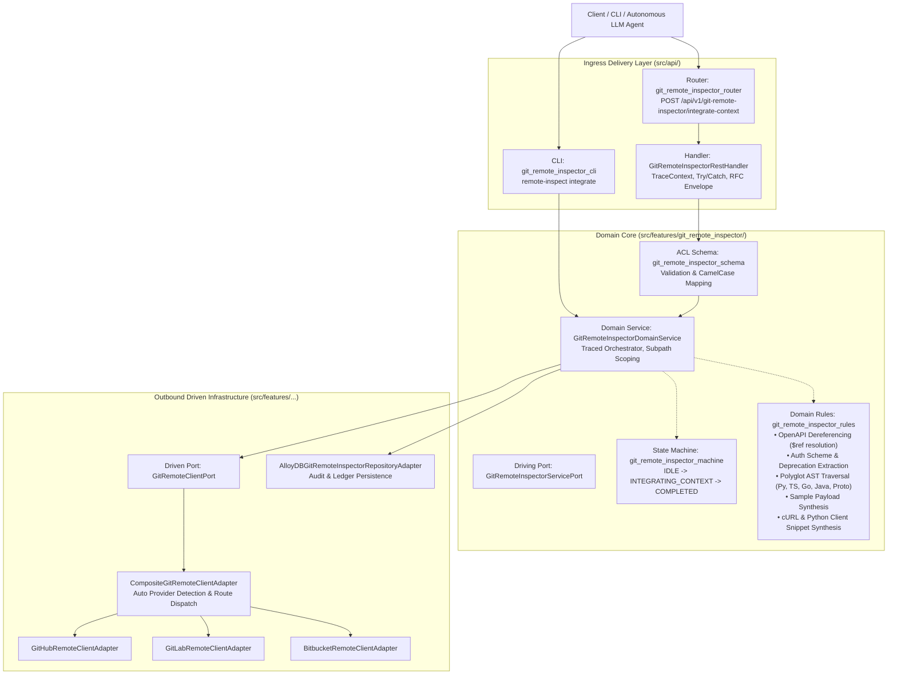
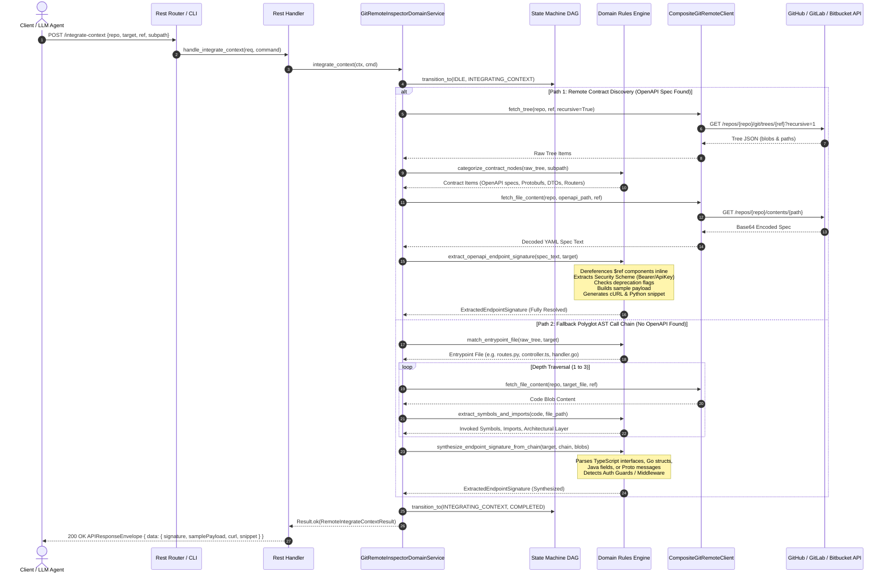

# ADR-0004: Zero-Clone Remote Microservice Integration Intelligence Engine

| Field | Value |
| :--- | :--- |
| **Status** | Accepted |
| **Date** | 2026-10-29 |
| **Deciders** | Platform Architecture Team, Policy Orchestrator Leads, Distributed Systems Guild |
| **Related Rules** | [1-feature-folder-writing-rule.md](../../../rules/folder-structure/1-feature-folder-writing-rule.md), [2-apis.writing.rule.md](../../../rules/folder-structure/2-apis.writing.rule.md), [03-single-responsibility-principle.md](../../../rules/code-quality/architecture-principles/03-single-responsibility-principle.md), [04-dry-rules-and-abstractions.md](../../../rules/code-quality/architecture-principles/04-dry-rules-and-abstractions.md) |
| **Supercedes / Extends** | [ADR-0003: Zero-Clone Remote Git Operations](ADR-0003-zero-clone-remote-git-operations.md) |
| **Implementation** | `src/features/git_remote_inspector` (`service/`, `contracts/`, `domain/rules/`, `api/`) |

---

## 1. Context & Problem Statement

In distributed enterprise microservice architectures, hundreds of autonomous services are developed across distinct repositories by independent teams in multiple programming languages (Python, TypeScript, Go, Java) and protocols (HTTP/REST, gRPC/Protobuf). When an engineer or an autonomous LLM agent needs to integrate Service A with Service B, standard workflows create major architectural friction:

1. **The Clone Overhead & Cold-Start Latency:** Developers or CI/CD pipelines must clone gigabytes of git history merely to locate a single endpoint's schema or DTO.
2. **Context Window Saturation in LLMs:** Dumping entire repositories into an AI agent's context window burns tokens, induces hallucinations, triggers rate limits, and injects private internal implementation noise.
3. **The Unresolved `$ref` Barrier:** Raw OpenAPI documents or schema models frequently hide critical shape definitions behind multi-level `$ref` pointers (e.g. `#/components/schemas/BillingRequestDTO`), forcing human engineers or LLMs into multi-hop manual file lookups.
4. **Undocumented Services (The Polyglot Reality):** Substantial legacy microservices lack maintained OpenAPI specifications, relying on raw router decorators, handler controllers, TypeScript interfaces, Go structs, or Spring Boot annotations.
5. **Cross-Branch & Monorepo Discrepancy:** Real development occurs on release branches (`release/v2.1`) or inside subfolders of large enterprise monorepos (`services/auth/`), requiring targeted scoping.
6. **Authentication Blindspots & Silent Deprecations:** Integrating without knowing the required security scheme (`BearerAuth`, `ApiKeyAuth`) causes initial calls to fail with 401s, while integrating against deprecated endpoints creates technical debt.

We require a zero-disk, sub-second **Microservice Integration Engine** that extracts fully resolved integration contracts, injects security schemes, parses polyglot signatures, generates runnable client snippets, and falls back to static AST call chain synthesis when formal OpenAPI contracts are missing.

---

## 2. Real-Life Production Scenarios Covered

```
                                REAL-LIFE SCENARIO COVERAGE MATRIX
   ┌──────────────────────────────────┬─────────────────────────────────────┬────────────────────────────────────┐
   │ Scenario                         │ Traditional Bottleneck              │ Zero-Clone Solution                │
   ├──────────────────────────────────┼─────────────────────────────────────┼────────────────────────────────────┤
   │ 1. Feature Branch Integration    │ Clone 2GB repo, checkout branch     │ Remote Merkle tree inspection by   │
   │                                  │                                     │ ref/tag                            │
   │ 2. Undocumented Service          │ 45m grepping router & DTO files     │ Polyglot AST Call Chain Tracing    │
   │                                  │                                     │ (Python, TS, Go, Java, Proto)      │
   │ 3. LLM Agent Adapter Generation  │ Context window overflow, hallu-     │ Dereferenced JSON Schema & sample  │
   │                                  │ cinated parameters                  │ payloads in sub-second API         │
   │ 4. Monorepo Path Isolation       │ Full monorepo tree noise            │ `--subpath` scoping filter         │
   │ 5. Auth Scheme Resolution        │ 401 Unauthorized trial-and-error    │ Automatic `securitySchemes`        │
   │                                  │                                     │ extraction (Bearer / API-Key)      │
   │ 6. Protobuf / gRPC Fleets        │ Lack of HTTP Swagger specs          │ `.proto` RPC & message field       │
   │                                  │                                     │ discovery                          │
   │ 7. Deprecation Notice Warning    │ Integrating against dying APIs      │ Detects `deprecated: true` flags   │
   │ 8. CI/CD Schema Breaking-Change  │ Runtime 422 errors after deployment │ Remote `diff` comparison across    │
   │    Gatekeeper                    │                                     │ semantic version tags              │
   └──────────────────────────────────┴─────────────────────────────────────┴────────────────────────────────────┘
```

---

## 3. High-Level Architecture (HLD)

The system operates as a stateless hexagonal capability within `policy-orchestrator`:



---

## 4. Low-Level Design (LLD) & Sequence Flow

When an integration command is received, the system evaluates the target repository via an automated dual-path resolution strategy:



---

## 5. ASCII Decision Tree: Resolution & Fallback Logic

```
                    INTEGRATION TARGET RESOLUTION TREE
                                  [Target]
                                     │
                    Is target URL or owner/repo provided?
                                ├── No ──> [Validation Error (HTTP 422)]
                                └── Yes
                                     │
                      Fetch Recursive Git Tree (Zero-Clone)
                                     │
             Is --subpath provided? (Monorepo Scoping)
                     ├── Yes ──> Filter tree to subfolder prefix
                     └── No  ──> Scan full repository tree
                                     │
                   Does repository contain OpenAPI / Swagger?
                                     ├── YES
                                     │    │
                                     │    Extract Paths & Methods from Spec
                                     │    Does endpoint / operationId match target?
                                     │         ├── YES
                                     │         │    ├── Dereference all $ref schemas inline
                                     │         │    ├── Extract Security Scheme (Bearer / API-Key)
                                     │         │    ├── Check `deprecated: true` notice
                                     │         │    ├── Synthesize concrete sample JSON body
                                     │         │    ├── Format copy-paste cURL command with auth
                                     │         │    └── Generate typed Python client snippet
                                     │         └── NO (Fallback to AST Traversal) ────────┐
                                     │                                                   │
                                     └── NO                                              │
                                          │                                              │
                                          ▼                                              │
                               ┌─────────────────────────────────────────────────────────┘
                               │
               Polyglot Static AST Remote Call Chain Traversal
                               │
            Match Entrypoint File (Routers / Controllers)
            (Python, TypeScript, Go, Java, Protobuf)
                               │
          Found? ──────────────┴───────────────┐
            │ NO                               │ YES
            ▼                                  ▼
   Search DTO Models              Inspect AST Calls & Imports
   by symbol name                              │
            │                                  ▼
            │                     Traverse Layer 1 -> Layer 2 -> Layer 3
            │                     (ROUTER -> SERVICE -> ADAPTER -> DOMAIN)
            │                                  │
            ▼                                  ▼
      Extract Struct/Interface Fields (Pydantic / TS Interface / Go Struct / Proto)
                                     │
      Detect Auth Guards (@UseGuards, Depends, Authorize)
                                     │
      Generate Actionable Artifacts: Headers + Payload + cURL + Client Snippet
```

---

## 6. Detailed Function Call Stack

```
GitRemoteInspectorRestHandler.handle_integrate_context(req, payload)
 └── GitRemoteInspectorDomainService.integrate_context(ctx, cmd)
      ├── OpenTelemetry.start_span("git_remote_inspector.integrate_context")
      ├── git_remote_inspector_machine.transition_to(STATE_IDLE, STATE_INTEGRATING_CONTEXT)
      │
      ├── [Sub-Step A: Contract Discovery & Monorepo Scoping]
      │    └── GitRemoteInspectorDomainService.discover_contracts(ctx, disc_cmd)
      │         ├── CompositeGitRemoteClientAdapter.fetch_tree(ctx, repo, ref, recursive=True)
      │         └── git_remote_inspector_rules.categorize_contract_nodes(raw_tree)
      │
      ├── [Branch A: OpenAPI Found]
      │    ├── GitRemoteInspectorDomainService.get_file_content(ctx, content_cmd)
      │    └── git_remote_inspector_rules.extract_openapi_endpoint_signature(spec_text, target)
      │         ├── _resolve_schema_ref(schema, components, depth=0)
      │         ├── Extract securitySchemes & deprecation flag
      │         ├── _generate_sample_payload(dereferenced_schema)
      │         └── _generate_client_snippet(method, path, sample_body, auth_scheme)
      │
      ├── [Branch B: Polyglot AST Traversal Fallback]
      │    ├── GitRemoteInspectorDomainService.trace_call_chain(ctx, chain_cmd)
      │    │    ├── git_remote_inspector_rules.match_entrypoint_file(raw_tree, symbol)
      │    │    └── (Loop depth <= 3) GitRemoteInspectorDomainService.get_file_content(...)
      │    │         └── git_remote_inspector_rules.extract_symbols_and_imports(...)
      │    └── git_remote_inspector_rules.synthesize_endpoint_signature_from_chain(...)
      │         ├── Parse Python Pydantic, TS Interfaces, Go Structs, Java Fields, Proto Messages
      │         ├── Detect Auth Guards & Protocol (HTTP_REST vs GRPC)
      │         └── _generate_client_snippet(method, path, sample_body, auth_scheme)
      │
      ├── git_remote_inspector_machine.transition_to(STATE_INTEGRATING_CONTEXT, STATE_COMPLETED)
      └── Result.ok(RemoteIntegrateContextResult)
```

---

## 7. How to Use (CLI & REST API)

### 7.1 CLI Subcommand

```bash
# 1. Standard OpenAPI resolution with auth header, sample payload, and client code
python3 src/api/cli/main.py remote-inspect integrate \
  --repo Scaibu/policy-orchestrator \
  --target search \
  --ref main

# 2. Monorepo subfolder scoped inspection
python3 src/api/cli/main.py remote-inspect integrate \
  --repo org/enterprise-monorepo \
  --subpath services/auth \
  --target login \
  --ref release/v2.1

# 3. Output as pure JSON for automated LLM prompt piping
python3 src/api/cli/main.py remote-inspect integrate \
  --repo Scaibu/policy-orchestrator \
  --target search \
  --json
```

### 7.2 REST API Invocation

**Endpoint:** `POST /api/v1/git-remote-inspector/integrate-context`  
**Headers:**
```http
Content-Type: application/json
traceparent: 00-4bf92f3577b34da6a3ce929d0e0e4736-00f067aa0ba902b7-01
x-request-id: req-integration-live-01
x-correlation-id: corr-integration-live-01
```

**Request Body:**
```json
{
  "repo_url": "Scaibu/policy-orchestrator",
  "endpoint_or_entity": "search",
  "ref_name": "main",
  "subpath": "contracts"
}
```

---

## 8. References & Contract Documents

1. [ADR-0003: Zero-Clone Remote Git Operations](ADR-0003-zero-clone-remote-git-operations.md)
2. [1-feature-folder-writing-rule.md](../../../rules/folder-structure/1-feature-folder-writing-rule.md) (Backend Hexagonal Segregation (01)–(14))
3. [2-apis.writing.rule.md](../../../rules/folder-structure/2-apis.writing.rule.md) (RFC Envelope & W3C Traceparent Invariants)
4. [03-single-responsibility-principle.md](../../../rules/code-quality/architecture-principles/03-single-responsibility-principle.md) (Pure Domain Rules vs Transport Ingress)
5. [GitHub Git Database REST API Documentation](https://docs.github.com/en/rest/git)
6. [OpenAPI 3.1.0 Specification ($ref Reference Object Dereferencing Rules)](https://spec.openapis.org/oas/latest.html#reference-object)
7. [Protocol Buffers Language Guide (proto3)](https://protobuf.dev/programming-guides/proto3/)
