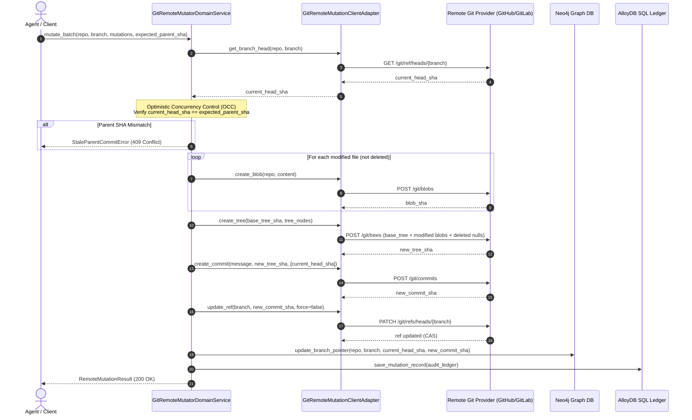

# ADR-0005: Zero-Clone Remote Git Mutation Engine (Git Merkle Plumbing)

| Field | Value |
| :--- | :--- |
| **Status** | Accepted |
| **Date** | 2026-10-29 |
| **Deciders** | Platform Architecture Team, Policy Orchestrator Leads, Distributed Systems Guild |
| **Related Rules** | [1-feature-folder-writing-rule.md](../../../rules/folder-structure/1-feature-folder-writing-rule.md), [2-apis.writing.rule.md](../../../rules/folder-structure/2-apis.writing.rule.md), [03-single-responsibility-principle.md](../../../rules/code-quality/architecture-principles/03-single-responsibility-principle.md), [04-dry-rules-and-abstractions.md](../../../rules/code-quality/architecture-principles/04-dry-rules-and-abstractions.md), [05-db-writing-rules.md](../../../rules/folder-structure/05-db-writing-rules.md) |
| **Supercedes / Extends** | [ADR-0004: Zero-Clone Remote Microservice Integration Intelligence Engine](ADR-0004-zero-clone-remote-microservice-integration-engine.md) |
| **Implementation** | `src/features/git_remote_mutator` (`service/`, `contracts/`, `domain/rules/`, `domain/machines/`, `infrastructure/`, `api/`) |

---

## 1. Context & Problem Statement

In automated code generation, AI agent workflows, and distributed microservice policy orchestration, agents and automated services need to modify remote codebases without cloning full gigabyte repositories to disk.

Standard naive approaches to remote file updates introduce critical failure modes:
1. **High-Level File Put Anti-Pattern (`PUT /repos/{owner}/{repo}/contents/{path}`):**
   - Updating 5 files produces 5 separate commits.
   - Triggers 5 sequential CI/CD build runs.
   - Exposes intermediate broken code states where some files are updated and others are not.
2. **Race Conditions & History Trampling:**
   - Concurrent agents or human developers pushing to the branch cause uncoordinated overwrites without parent commit verification.
3. **Graph Desynchronization:**
   - If git remote references advance, knowledge graph representations (Neo4j branch pointers `(:GitBranch)-[:POINTS_TO]->(:GitCommit)`) become stale unless synchronized atomically with the mutation.

---

## 2. Decision: Low-Level Git Merkle Plumbing & OCC

We adopt low-level Git object plumbing primitives executed over HTTPS APIs:

---

## 3. Optimistic Concurrency Control (OCC) Semantics

- Every mutating command supports an optional `expected_parent_sha`.
- If provided and unequal to remote `HEAD`, the mutation aborts immediately before any blobs or trees are written, throwing `StaleParentCommitError` (HTTP 409).
- The final reference update uses atomic compare-and-swap (`force=false`), guaranteeing that fast-forward rejection surfaces as `RefUpdateConflictError` (HTTP 409) if another commit landed concurrently.

---

## 4. Consequences & Benefits

- **True Atomicity:** Batch mutations across 100+ files commit in a single immutable Merkle tree.
- **Zero Disk Footprint:** No local git clones, checkouts, or worktrees are created.
- **Graph Consistency:** Neo4j `(:GitBranch)-[:POINTS_TO]->(:GitCommit)` is updated immediately upon CAS confirmation.
- **Auditability:** Every mutation is ledgered in PostgreSQL/AlloyDB `git_remote_mutation_records` with execution timing and SHA lineage.
