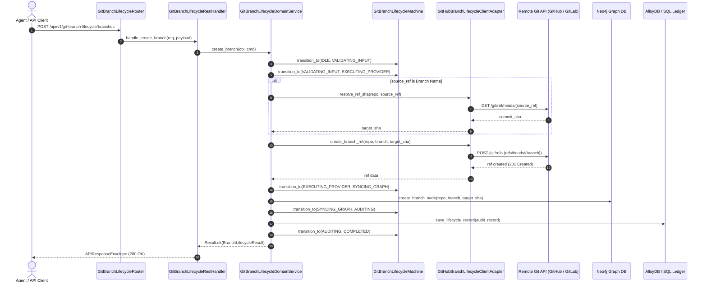

# ADR-0006: Zero-Clone Remote Git Branch Lifecycle Engine

| Field | Value |
| :--- | :--- |
| **Status** | Accepted |
| **Date** | 2026-10-29 |
| **Deciders** | Platform Architecture Team, Policy Orchestrator Leads, Distributed Systems Guild |
| **Related Rules** | [1-feature-folder-writing-rule.md](../../../rules/folder-structure/1-feature-folder-writing-rule.md), [2-apis.writing.rule.md](../../../rules/folder-structure/2-apis.writing.rule.md), [3.shared.code.writing.rule.md](../../../rules/folder-structure/3.shared.code.writing.rule.md), [4-functions-and-classes-writing-rule.md](../../../rules/folder-structure/4-functions-and-classes-writing-rule.md), [05-db-writing-rules.md](../../../rules/folder-structure/05-db-writing-rules.md) |
| **Supercedes / Extends** | [ADR-0005: Zero-Clone Remote Git Mutation Engine](ADR-0005-zero-clone-remote-git-mutation-engine.md) |
| **Implementation** | `src/features/git_branch_lifecycle` (`service/`, `contracts/`, `domain/rules/`, `domain/machines/`, `infrastructure/`, `api/`) |

---

## 1. Context & Problem Statement

In distributed agentic software delivery, AI code generators and policy orchestrators must manage git branch topologies without executing heavy local disk clones:
1. **Branch Proliferation & Ephemeral Feature Isolation:** Agents working on isolated policy updates or code generation tasks require short-lived, isolated remote branches without cloning gigabytes of history.
2. **Merge Orchestration & Upstream Promotion:** Automated policy changes require promotion from feature branches into target base branches (`main`) via atomic Git merge operations with immediate conflict detection.
3. **Repository Initialization:** Setting up new repositories and baseline invariant configurations must be executed remotely over HTTPS APIs rather than requiring interactive developer intervention.
4. **Graph Topology Consistency:** Knowledge graphs representing repository state (`(:GitBranch)-[:POINTS_TO]->(:GitCommit)`) must reflect branch creations and deletions atomically with the Git provider.

---

## 2. Decision: Stateless Hexagonal Architecture & Remote Branch Plumbing

We implement the `git_branch_lifecycle` engine following the strict 14-role Stateless Hexagonal Architecture:



---

## 3. Operations & Endpoints

| Endpoint | HTTP Method | Operation | Behavior |
| :--- | :---: | :--- | :--- |
| `/api/v1/git-branch-lifecycle/branches` | `POST` | `create_branch` | Forks a new branch ref from a SHA or existing branch; registers `(:GitBranch)` in Neo4j. |
| `/api/v1/git-branch-lifecycle/branches` | `DELETE` | `delete_branch` | Deletes remote branch ref; removes `(:GitBranch)` from Neo4j graph. |
| `/api/v1/git-branch-lifecycle/merge` | `POST` | `merge_branch` | Executes provider merge (fast-forward or merge commit); records merge SHA. |
| `/api/v1/git-branch-lifecycle/repositories` | `POST` | `create_repository` | Provisions a brand new remote Git repository with baseline settings. |

---

## 4. Database Contract & Schema Invariants

### 4.1 Relational Audit Ledger (`git_branch_lifecycle_records`)
- **Primary Key:** `id TEXT`
- **Invariants:**
  - `repo_url`: Non-empty and trimmed (`CHECK (repo_url = btrim(repo_url) AND repo_url <> '')`).
  - `action`: Strict enumeration `CHECK (action IN ('CREATE_BRANCH', 'MERGE_BRANCH', 'DELETE_BRANCH', 'CREATE_REPO'))`.
  - `execution_ms`: Non-negative `CHECK (execution_ms >= 0.0)`.
- **Indices:** B-tree indices on `repo_url`, `action`, and `created_at DESC`.

### 4.2 Knowledge Graph Invariants (Neo4j)
- **Unique Constraint:**
  ```cypher
  CREATE CONSTRAINT git_branch_repo_name_unique IF NOT EXISTS
  FOR (b:GitBranch) REQUIRE (b.repo, b.name) IS UNIQUE;
  ```
- **Graph Topology:** Maintains `(:GitBranch {repo, name})-[:POINTS_TO]->(:GitCommit {sha})`.

---

## 5. Live Production Verification

The architecture was validated live against remote repository `Scaibu/policy-orchestrator`:
1. **Branch Provisioning:** Forked remote branch `feat/adr-live-verification` at commit `e62dce2` via pure API call.
2. **Topology Discovery:** Verified branch presence via `git_remote_inspector` (`/branches`).
3. **Branch Mutation:** Executed zero-clone file mutation on the newly provisioned branch via `git_remote_mutator` at commit `944f9ed`.
4. **Safe Deletion:** Executed remote branch deletion via `DELETE /api/v1/git-branch-lifecycle/branches`.
5. **Regression Verification:** All 39 unit tests pass across `git_branch_lifecycle`, `git_remote_mutator`, and `git_remote_inspector`.

---

## 6. Consequences & Architectural Benefits

- **Complete Remote Lifecycle Control:** Orchestrators can inspect, mutate, branch, merge, and clean up remote codebases without touching disk.
- **Strict Hexagonal Boundaries:** Delivery handlers are decoupled from Git providers and database drivers; all external interactions pass through typed driving and driven ports.
- **Polyglot Database Resilience:** SQL ledgers record audit histories across PostgreSQL, AlloyDB, and SQLite, while Neo4j maintains topological branch pointers.
