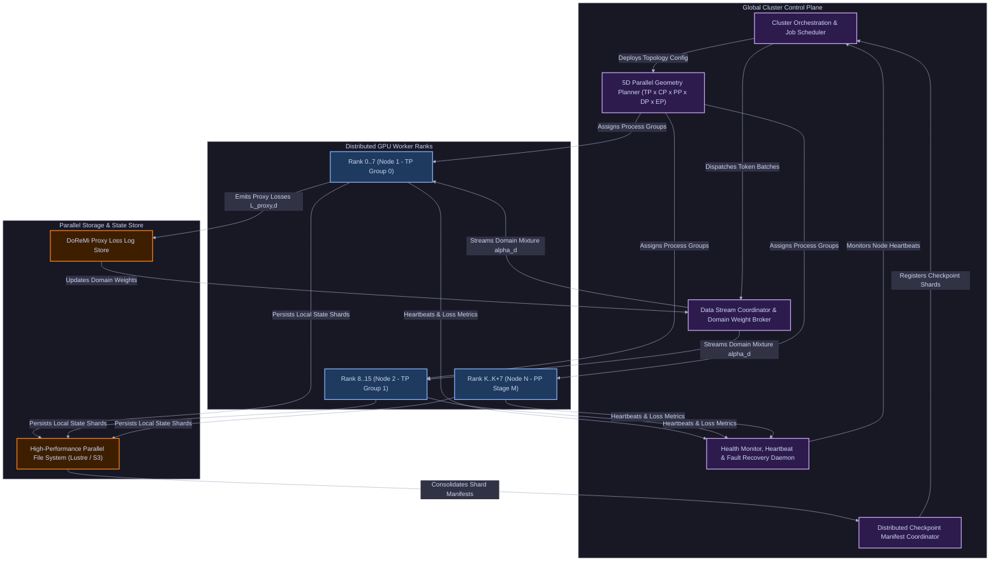
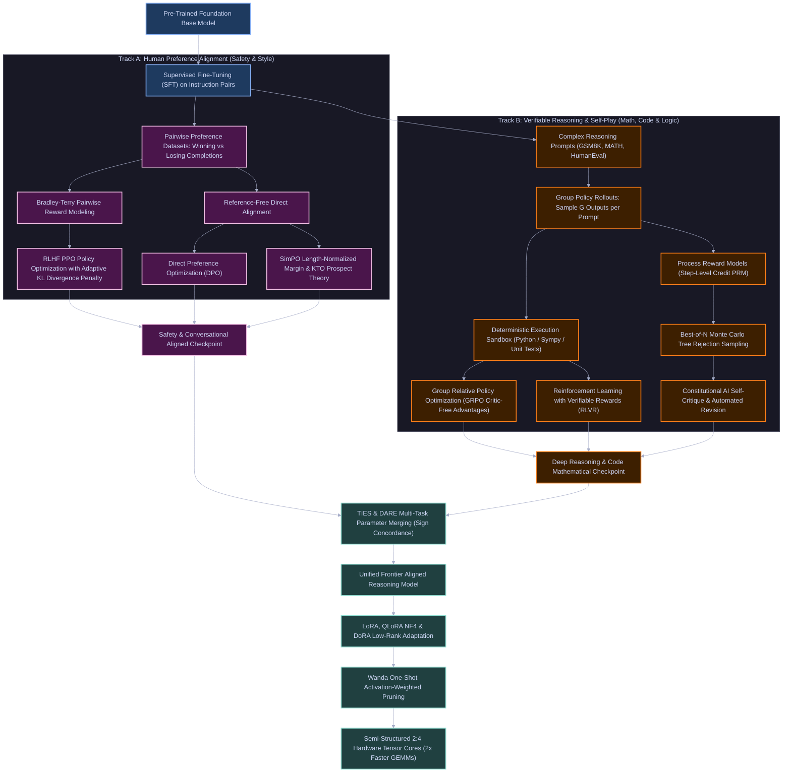

# Neural Network Foundation & Frontier Engine (`algos/nn`)

[-success.svg)](file:///home/btpl-lap-22/live/llm-obs-infra/policies/policy-orchestrator/src/features/code_engine/algos/nn)
[](file:///home/btpl-lap-22/live/llm-obs-infra/policies/policy-orchestrator/src/features/code_engine/algos/nn)
[-brightgreen.svg)](file:///home/btpl-lap-22/live/llm-obs-infra/policies/policy-orchestrator/src/features/code_engine/algos/nn)
[](file:///home/btpl-lap-22/live/llm-obs-infra/policies/policy-orchestrator/src/features/code_engine/algos/nn)
[](file:///home/btpl-lap-22/live/llm-obs-infra/policies/policy-orchestrator/src/features/code_engine/algos/nn)
[](file:///home/btpl-lap-22/live/llm-obs-infra/policies/policy-orchestrator/tests/unit/algos)

> **Complete, Deterministic Scalar Neural Network Engine (Algorithms #001 to #250)**  
> *Every mathematical operator, transformer micro-architecture, distributed 5D parallel scaling primitive, post-training alignment recipe, PEFT adapter, and inference optimization algorithm implemented from first principles with zero external dependencies (`torch`, `numpy` free).*

---

## 1. System Architecture: How All 250 Components Combine Into One

The **250 algorithms** in this repository are not isolated routines; they form an interconnected, production-grade computational graph spanning the entire life cycle of frontier foundation models and Large Language Models (LLMs).

Below is the complete architectural specification across:
1. **Master End-to-End System Blueprint** (Unified Lifecycle Data Flow)
2. **Control Plane Architecture** (High-Level Cluster Orchestration & Low-Level Per-Step Adaptive Controllers)
3. **Data Plane & Distributed Messaging Topology** (5D Interconnect Fabrics & Intra-Block Tensor Pipelines)
4. **Post-Training Alignment & Verifiable Reasoning Engine** (Dual-Track Synthesis Loop)
5. **Production Inference Serving & Constrained Generation Engine**

---

### 1.1 Master End-to-End System Blueprint

The diagram below illustrates the end-to-end journey of building, scaling, aligning, compressing, and serving a frontier LLM using the components in this repository:

```mermaid
%%{init: {"theme": "base", "themeVariables": {"primaryColor": "#1e1e2e", "primaryTextColor": "#cdd6f4", "primaryBorderColor": "#89b4fa", "lineColor": "#a6adc8", "secondaryColor": "#181825", "tertiaryColor": "#11111b", "background": "#1e1e2e", "mainBkg": "#1e1e2e", "nodeBorder": "#89b4fa", "clusterBkg": "#181825", "clusterBorder": "#45475a", "titleColor": "#cdd6f4", "edgeLabelBackground": "#313244", "fontFamily": "ui-monospace, monospace"}}}%%
flowchart TD
    classDef data fill:#1e3a5f,stroke:#89b4fa,stroke-width:2px,color:#cdd6f4;
    classDef arch fill:#2d1b4e,stroke:#cba6f7,stroke-width:2px,color:#cdd6f4;
    classDef scale fill:#3d1f00,stroke:#fe8019,stroke-width:2px,color:#cdd6f4;
    classDef opt fill:#1a3300,stroke:#a6e3a1,stroke-width:2px,color:#cdd6f4;
    classDef align fill:#4a154b,stroke:#f5c2e7,stroke-width:2px,color:#cdd6f4;
    classDef peft fill:#2e3440,stroke:#88c0d0,stroke-width:2px,color:#cdd6f4;
    classDef serve fill:#204040,stroke:#94e2d5,stroke-width:2px,color:#cdd6f4;

    %% -------------------------------------------------------------------------
    %% PHASE 1: DATA CURATION & PREPARATION
    %% -------------------------------------------------------------------------
    subgraph P1 ["Phase 1: Data Curation, Filtering & Sequence Preparation"]
        RawCorpora["Raw Pre-Training Web, Code & Math Corpora"]:::data
        SynthGen["Synthetic Candidate Stream"]:::data

        SynthGen --> FilterQual["Synthetic Quality Gate & Token Length Bounds"]:::data
        FilterQual --> FilterDedup["Incremental Jaccard Deduplication Hash Pool"]:::data
        RawCorpora --> DoReMiProxy["DoReMi Proxy vs Reference Excess Loss Engine"]:::data
        FilterDedup --> DoReMiProxy

        DoReMiProxy --> SimplexWeights["Dynamic Simplex Mixture Weights alpha_d"]:::data
        SimplexWeights --> SeqPack["Sequence Packing with Best-Fit Decreasing"]:::data
        SeqPack --> DocMask["Causal 2D Block-Diagonal Document Masking"]:::data
    end

    %% -------------------------------------------------------------------------
    %% PHASE 2: TRANSFORMER MICRO-ARCHITECTURE
    %% -------------------------------------------------------------------------
    subgraph P2 ["Phase 2: Transformer Block Micro-Architecture & Dynamics"]
        DocMask --> InTokens["Packed Token Sequence [Batch, SeqLen]"]:::arch
        InTokens --> EmbLookup["Embedding Lookup & High-Dimensional Projections"]:::arch
        EmbLookup --> PreNorm["Pre-Attention RMSNorm Layer Normalization"]:::arch

        PreNorm --> QKVProj["Linear Q, K, V Projections"]:::arch
        QKVProj --> RoPE["Rotary Position Embeddings (RoPE)"]:::arch
        QKVProj --> YaRN["Context Extension (YaRN & LongRoPE)"]:::arch

        RoPE --> AttnEngine["FlashAttention Causal Tiled Computation"]:::arch
        YaRN --> AttnEngine
        AttnEngine --> AttnSinks["Attention Sinks & Streaming Context Preservation"]:::arch

        AttnSinks --> OutProj["Attention Output Projection Matrix"]:::arch
        OutProj --> ResDrop1["Residual Addition + DropPath Stochastic Depth"]:::arch

        ResDrop1 --> PostNorm["Pre-FFN RMSNorm Normalization"]:::arch
        PostNorm --> MoERouter["Top-K Softmax Mixture-of-Experts Router"]:::arch

        MoERouter --> SwiGLU["SwiGLU Gated Feedforward Expert Networks"]:::arch
        SwiGLU --> ResDrop2["Residual Addition + Highway Connections"]:::arch
    end

    %% -------------------------------------------------------------------------
    %% PHASE 3: 5D DISTRIBUTED TRAINING AT SCALE
    %% -------------------------------------------------------------------------
    subgraph P3 ["Phase 3: 5D Distributed Cluster Scaling & Hardware Execution"]
        ResDrop2 --> MegatronTP["Tensor Parallelism (Column & Row Linear All-Reduce)"]:::scale
        MegatronTP --> RingCP["Context Parallelism (Ring Attention Token Exchange)"]:::scale
        RingCP --> PipePP["Pipeline Parallelism (1F1B Interleaved Schedule)"]:::scale
        PipePP --> ExpertEP["Expert Parallelism (All-to-All Token Dispatch)"]:::scale

        ExpertEP --> ZeRO3["ZeRO-3 / FSDP Fully Sharded Parameters & Optimizers"]:::scale
        ZeRO3 --> FloatPrecision["Mixed Precision (BF16 & FP8 Tensor Cores)"]:::scale
        FloatPrecision --> Offload["Activation Checkpointing & Host CPU Offloading"]:::scale
    end

    %% -------------------------------------------------------------------------
    %% PHASE 4: OPTIMIZATION, LOSS & RECOVERY
    %% -------------------------------------------------------------------------
    subgraph P4 ["Phase 4: Objective Loss, Autodiff & Gradient Dynamics"]
        Offload --> CrossEntropy["Cross-Entropy Loss with Label Smoothing"]:::opt
        CrossEntropy --> ZLoss["Logit Stabilization Z-Loss Regularization"]:::opt

        ZLoss --> AutodiffVJP["Reverse-Mode Autodiff Vector-Jacobian Products"]:::opt
        AutodiffVJP --> GradAccum["Gradient Accumulation Micro-Batch Buffer"]:::opt
        GradAccum --> NoiseScale["Critical Batch Size & Gradient Noise Scale Monitor"]:::opt

        NoiseScale --> AdamW["Adaptive Optimizers (AdamW, Adafactor, Lion, Muon)"]:::opt
        AdamW --> MuP["Maximal Update Parametrization (muP Width Transfer)"]:::opt
        MuP --> WSD["Warmup-Stable-Decay (WSD) Learning Rate Schedule"]:::opt

        WSD --> SpikeDetect["Loss Spike Detection & Health Diagnostics"]:::opt
        SpikeDetect --> ElasticDCP["Distributed Checkpointing & Elastic Resharding"]:::opt
    end

    %% -------------------------------------------------------------------------
    %% PHASE 5: POST-TRAINING ALIGNMENT & REASONING
    %% -------------------------------------------------------------------------
    subgraph P5 ["Phase 5: Post-Training Alignment, Reasoning & Self-Play"]
        ElasticDCP --> SFT["Supervised Fine-Tuning (SFT)"]:::align
        
        SFT --> TrackPrefs["Human Preference Alignment Track"]:::align
        SFT --> TrackReason["Verifiable Mathematical Reasoning Track"]:::align

        TrackPrefs --> RewardModel["Bradley-Terry Pairwise Reward Modeling"]:::align
        RewardModel --> RLHF["RLHF PPO Policy Gradient with KL Divergence Penalty"]:::align
        TrackPrefs --> DPO["Direct Alignment: DPO, SimPO & KTO"]:::align

        TrackReason --> GRPO["Group Relative Policy Optimization (GRPO)"]:::align
        TrackReason --> RLVR["Reinforcement Learning with Verifiable Rewards (RLVR)"]:::align
        RLVR --> PRM["Process Reward Models (Step-Level Credit PRM)"]:::align
        PRM --> ConstAI["Constitutional AI Self-Critique & Best-of-N Rejection"]:::align
    end

    %% -------------------------------------------------------------------------
    %% PHASE 6: PEFT, MERGING, DISTILLATION & PRUNING
    %% -------------------------------------------------------------------------
    subgraph P6 ["Phase 6: Parameter-Efficiency, Compression & Hardware Pruning"]
        ConstAI --> LoRA["LoRA, QLoRA NF4 & DoRA Low-Rank Adapters"]:::peft
        DPO --> LoRA
        RLHF --> LoRA

        LoRA --> ModelMerge["TIES & DARE Multi-Task Model Merging"]:::peft
        ModelMerge --> Distill["Knowledge Distillation (Soft Targets & On-Policy)"]:::peft
        Distill --> Continual["Continual Learning (EWC & Experience Replay)"]:::peft

        Continual --> Wanda["Wanda One-Shot Activation-Weighted Pruning"]:::peft
        Wanda --> Sparse24["Semi-Structured 2:4 Hardware Sparse Tensor Cores"]:::peft
    end

    %% -------------------------------------------------------------------------
    %% PHASE 7: ULTRA-FAST INFERENCE DECODING
    %% -------------------------------------------------------------------------
    subgraph P7 ["Phase 7: Production Inference Serving & Constrained Generation"]
        Sparse24 --> PagedKV["PagedAttention Virtual Memory KV Cache Pool"]:::serve
        PagedKV --> FlashDecode["FlashDecoding Parallel Split-K Attention Reduction"]:::serve
        FlashDecode --> Speculative["Speculative Draft-Verify Accelerated Sampling"]:::serve
        Speculative --> GrammarEngine["Constrained CFG & JSON Grammar Finite State Machine"]:::serve
        GrammarEngine --> Contrastive["Contrastive Search & Min-P Temperature Sampling"]:::serve
        Contrastive --> FinalTokens["Deterministic, Aligned, Verifiable Generation"]:::serve
    end
```



---

### 1.2 Control Plane Architecture: High-Level & Low-Level

The **Control Plane** orchestrates cluster topology assignment, elastic state synchronization, fault tolerance, and per-iteration adaptive feedback loops.

#### 1.2.1 High-Level Control Plane & Cluster Orchestration



#### 1.2.2 Low-Level Control Plane: Per-Iteration Dynamic Adaptive Feedback Loops

Inside every single optimization step, five low-level control loops dynamically tune execution parameters based on real-time mathematical telemetry:

```mermaid
%%{init: {"theme": "base", "themeVariables": {"primaryColor": "#1e1e2e", "primaryTextColor": "#cdd6f4", "primaryBorderColor": "#89b4fa", "lineColor": "#a6adc8", "secondaryColor": "#181825", "tertiaryColor": "#11111b", "background": "#1e1e2e", "mainBkg": "#1e1e2e", "nodeBorder": "#89b4fa", "clusterBkg": "#181825", "clusterBorder": "#45475a", "titleColor": "#cdd6f4", "edgeLabelBackground": "#313244", "fontFamily": "ui-monospace, monospace"}}}%%
flowchart TD
    classDef telemetry fill:#1e3a5f,stroke:#89b4fa,stroke-width:2px,color:#cdd6f4;
    classDef controller fill:#2d1b4e,stroke:#cba6f7,stroke-width:2px,color:#cdd6f4;
    classDef action fill:#1a3300,stroke:#a6e3a1,stroke-width:2px,color:#cdd6f4;
    classDef alert fill:#3d1f00,stroke:#fe8019,stroke-width:2px,color:#cdd6f4;

    StepExec["Step t Execution (Forward + Backward Pass)"]:::telemetry

    %% Control Loop 1: Noise Scale
    StepExec -->|Per-Sample Gradient Covariance| Telemetry1["tr(Sigma) and ||G||^2 Telemetry"]:::telemetry
    Telemetry1 --> CtlNoise["Critical Batch Noise Scale Controller"]:::controller
    CtlNoise -->|Computes B_noise = tr(Sigma) / ||G||^2| ActBatch["Adapts Micro-Batch Size & Gradient Accumulation Count"]:::action

    %% Control Loop 2: Loss Spike Watchdog
    StepExec -->|Step Loss L_t and Gradient Norm ||g_t||| Telemetry2["Loss & Gradient Norm Telemetry"]:::telemetry
    Telemetry2 --> CtlSpike["Loss Spike & Divergence Watchdog"]:::controller
    CtlSpike -->|If L_t > MovingAvg + 4*StdDev| AlertRollback["Trigger Rollback to Checkpoint t-100"]:::alert
    CtlSpike -->|If Normal| ActLR["Apply Warmup-Stable-Decay Learning Rate"]:::action
    AlertRollback -->|Attenuate Learning Rate by 50%| ActLR

    %% Control Loop 3: FP8 & Mixed-Precision Scaler
    StepExec -->|Tensor Max Absolute Value amax| Telemetry3["FP8 Quantization Exponent Telemetry"]:::telemetry
    Telemetry3 --> CtlFP8["Dynamic Delayed Loss & Tensor Scaler"]:::controller
    CtlFP8 -->|Detects Inf/NaN Overflow| ActSkip["Skip Optimizer Step & Downscale Scale Factor S"]:::alert
    CtlFP8 -->|Stable Dynamic Range| ActScale["Upscale S for Maximum FP8 Mantissa Utilization"]:::action

    %% Control Loop 4: DoReMi Domain Mixture
    StepExec -->|Domain Cross-Entropy Losses| Telemetry4["Proxy vs Reference Domain Losses"]:::telemetry
    Telemetry4 --> CtlDoReMi["DoReMi Simplex Mirror Descent Controller"]:::controller
    CtlDoReMi -->|Exponentiated Excess Loss Update| ActMixture["Adjust Next Epoch Domain Sampling Probabilities"]:::action

    %% Actions feed into next step
    ActBatch --> NextStep["Configure Step t+1 Parameters"]:::telemetry
    ActLR --> NextStep
    ActScale --> NextStep
    ActMixture --> NextStep
```

---

### 1.3 Data Plane & Distributed Messaging Topology: High-Level & Low-Level

The **Data Plane** handles high-throughput numerical tensor computation, collective networking operations, and memory hierarchy staging across GPUs.

#### 1.3.1 High-Level 5D Distributed Messaging Fabric & Collective Topologies

Frontier models partition tensor representations across five orthogonal communication planes:


#### 1.3.2 Low-Level Intra-Block Tensor Data Plane (Forward Pass, Micro-Tiling & Backward VJP)

Inside each transformer block, the exact tensor shapes $[B, S, D]$, matrix multiplications, rotary embeddings, causal softmax reductions, and reverse-mode autodiff vector-jacobian products flow as follows:

```mermaid
%%{init: {"theme": "base", "themeVariables": {"primaryColor": "#1e1e2e", "primaryTextColor": "#cdd6f4", "primaryBorderColor": "#89b4fa", "lineColor": "#a6adc8", "secondaryColor": "#181825", "tertiaryColor": "#11111b", "background": "#1e1e2e", "mainBkg": "#1e1e2e", "nodeBorder": "#89b4fa", "clusterBkg": "#181825", "clusterBorder": "#45475a", "titleColor": "#cdd6f4", "edgeLabelBackground": "#313244", "fontFamily": "ui-monospace, monospace"}}}%%
flowchart TD
    classDef tensor fill:#1e3a5f,stroke:#89b4fa,stroke-width:2px,color:#cdd6f4;
    classDef op fill:#2d1b4e,stroke:#cba6f7,stroke-width:2px,color:#cdd6f4;
    classDef comm fill:#3d1f00,stroke:#fe8019,stroke-width:2px,color:#cdd6f4;
    classDef bwd fill:#1a3300,stroke:#a6e3a1,stroke-width:2px,color:#cdd6f4;

    %% Forward Pass Flow
    subgraph FwdPipeline ["Forward Tensor Computation Pipeline"]
        X_in["Input Hidden States X: Shape [Batch, SeqLen, HiddenDim]"]:::tensor --> LN1["Pre-Attention RMSNorm: x_norm = x / sqrt(mean(x^2) + eps)"]:::op
        LN1 --> ColGEMM["Column-Parallel GEMM: W_q, W_k, W_v [HiddenDim, 3 * HeadDim * NumHeads / TP]"]:::op
        ColGEMM --> RoPE_Kernel["Rotary Position Embeddings: Q_rot = R_theta * Q, K_rot = R_theta * K"]:::op

        RoPE_Kernel --> FlashTiling["FlashAttention Kernel: Tiled Online Softmax over SRAM Blocks"]:::op
        FlashTiling --> OutGEMM["Row-Parallel Output GEMM: W_o [HiddenDim / TP, HiddenDim]"]:::op
        OutGEMM --> TP_AllRed1["Tensor Parallel All-Reduce Sum Collective"]:::comm

        TP_AllRed1 --> ResAdd1["Residual Connection: X_mid = X + Dropout(AttnOut)"]:::op
        ResAdd1 --> LN2["Pre-FFN RMSNorm: x_mid_norm = x_mid / sqrt(mean(x_mid^2) + eps)"]:::op

        LN2 --> MoERoute["Top-K Softmax Gating: Softmax(W_gate * x_mid_norm)"]:::op
        MoERoute --> EP_Dispatch["All-to-All Token Dispatch Collective across Expert Ranks"]:::comm
        EP_Dispatch --> SwiGLU_GEMM["SwiGLU Expert GEMMs: (W_gate * x) * Silu(W_up * x)"]:::op
        SwiGLU_GEMM --> EP_Combine["All-to-All Token Combine Collective"]:::comm

        EP_Combine --> DownGEMM["Row-Parallel Down Projection GEMM: W_down"]:::op
        DownGEMM --> TP_AllRed2["Tensor Parallel All-Reduce Sum Collective"]:::comm
        TP_AllRed2 --> ResAdd2["Residual Connection: X_out = X_mid + FFN(X_mid)"]:::op
        ResAdd2 --> Out_Tensor["Output Hidden States X_out: Shape [Batch, SeqLen, HiddenDim]"]:::tensor
    end

    %% Backward Pass Flow
    subgraph BwdPipeline ["Backward Autodiff & Gradient Flow (VJP)"]
        dOut["Incoming Loss Gradient dX_out: Shape [Batch, SeqLen, HiddenDim]"]:::tensor --> dDownGEMM["Autodiff VJP through Down Projection GEMM"]:::bwd
        dDownGEMM --> dSwiGLU["Autodiff VJP through SwiGLU Gated Multiplier"]:::bwd
        dSwiGLU --> dMoERoute["Autodiff VJP through Top-K Gating Router"]:::bwd

        dMoERoute --> dLN2["Autodiff VJP through Pre-FFN RMSNorm"]:::bwd
        dLN2 --> dOutGEMM["Autodiff VJP through Output Projection GEMM"]:::bwd
        dOutGEMM --> dFlash["Autodiff VJP through FlashAttention Online Tiling"]:::bwd
        dFlash --> dRoPE["Autodiff VJP through Rotary Kernel"]:::bwd
        dRoPE --> dQKV["Autodiff VJP through QKV Column Projections"]:::bwd
        dQKV --> dLN1["Autodiff VJP through Pre-Attention RMSNorm"]:::bwd

        dLN1 --> GradSync["ZeRO-2 / FSDP Reduce-Scatter Gradient Accumulation"]:::comm
        GradSync --> OptStep["Sharded AdamW Weight Mutation: theta = theta - lr * m_hat / (sqrt(v_hat) + eps)"]:::bwd
    end

    Out_Tensor -.->|Feeds Objective Loss Function| dOut
```



---

### 1.4 Post-Training Alignment & Verifiable Reasoning Loop

Post-training splits into two parallel pipelines: **Human Preference Alignment** and **Verifiable Mathematical/Code Reasoning**, which synthesize into unified frontier checkpoints:



---

### 1.5 Production Inference Serving & Constrained Generation Data Plane

The diagram below maps the inference pipeline from continuous request ingestion to token streaming:


---

## 2. End-to-End Computational Walkthrough: Token to Generation

Every stage of a production LLM's life cycle is directly mapped to concrete algorithms in this directory:

### Step 1: Pre-Training Data Preparation & Ingestion
1. **Synthetic Data Quality Filtering and Deduplication** (`training_at_scale/synthetic_data_generation_filtering`): Validates incoming candidate documents against quality scores, token length boundaries, and incremental Jaccard similarity to reject hallucinations and prevent model collapse.
2. **DoReMi Dynamic Domain Reweighting** (`training_at_scale/data_mixture_optimization_doremi`): Employs a small proxy model against a reference baseline to calculate excess loss $\Delta_d = L_{\text{proxy}, d} - L_{\text{ref}, d}$, updating domain mixture weights $\boldsymbol{\alpha}$ via exponentiated gradient mirror descent to avoid noisy domain starvation.
3. **Sequence Packing with Causal Document Masking** (`training_at_scale/sequence_packing_doc_masking`): Packs multiple variable-length documents into fixed-length sequences (e.g., 4096 or 8192 tokens) using cumulative segment index offsets to construct 2D block-diagonal causal masks, eliminating cross-document token attention leakage and padding bubble waste.

### Step 2: Transformer Layer Construction & Forward Propagation
1. **Token & Position Embedding**: Inputs pass through `building_blocks/embedding_lookup`, augmented by rotary position embeddings (`position_encodings/rotary_position_embeddings_rope`) or linear biases (`position_encodings/alibi_attention_linear_biases`).
2. **Pre-Layer Normalization**: Evaluated through `normalization/rmsnorm` or `normalization/layer_normalization`, stabilizing activations across extreme depths without mean computation.
3. **Efficient Multi-Head Attention**: Token representations are processed by `transformer_efficiency/flash_attention` or `transformer_efficiency/grouped_query_attention`, with persistent KV cache management via `transformer_efficiency/kv_cache`.
4. **MoE Routing & Feed-Forward**: For sparse models, `mixture_of_experts/moe_top_k_gating` routes tokens across expert feed-forward networks with auxiliary load balancing (`mixture_of_experts/moe_load_balancing`) and gated linear activations (`building_blocks/gated_linear_units`).
5. **Stability & Sink Protection**: Softmax attention utilizes `scaling_stability/attention_sinks_streaming` to preserve initial sequence tokens, and `scaling_stability/logit_stabilization_z_loss` penalizes large log-sum-exp partitions.

### Step 3: Massive Distributed Execution (3D/5D Parallelism)
1. **Tensor Parallelism** (`training_at_scale/tensor_parallelism_megatron`): Shards column-parallel projections ($W_q, W_k, W_v, W_{\text{gate}}$) and row-parallel projections ($W_o, W_{\text{down}}$) across GPU intra-node NVLink meshes via All-Reduce synchronization.
2. **Sequence & Context Parallelism** (`training_at_scale/context_parallelism_ring_attention`): Splits multi-hundred-thousand token sequences across GPUs in a ring topology, overlapping causal block computation with peer-to-peer communication.
3. **Pipeline Parallelism** (`training_at_scale/pipeline_parallelism_1f1b`): Schedules micro-batches in a 1-Forward-1-Backward pipeline across multi-node stages, minimizing memory bubbles.
4. **Memory Sharding & Offloading** (`training_at_scale/zero_fsdp_sharded_training`; `offloading_activation_parameter`): Eliminates memory redundancy across data-parallel ranks by partitioning optimizer states (ZeRO-1), gradients (ZeRO-2), and model parameters (ZeRO-3/FSDP), offloading inactive layers to host CPU RAM.
5. **Numerical Precision** (`training_at_scale/mixed_precision_training`; `fp8_training`): Runs forward/backward passes in FP16/BF16 with dynamic loss scaling, or FP8 E4M3/E5M2 tensor cores with per-tensor delayed scaling.

### Step 4: Gradient Calculation, Optimization & Resumption
1. **Loss Evaluation**: Target predictions compute `losses/cross_entropy_nll` with label smoothing (`losses/label_smoothing`) and z-loss logit regularization.
2. **Autodiff & Backpropagation**: Gradients flow via `autodiff/reverse_mode_automatic_differentiation` with activation recomputation via `autodiff/gradient_checkpointing`.
3. **Noise Scale & Critical Batch Tuning**: Evaluates `training_at_scale/critical_batch_size_noise_scale` using gradient covariance trace $\operatorname{tr}(\Sigma) / \|G\|^2$ to maintain optimal compute efficiency.
4. **Parameter Updates**: Weights update through `optimizers/adamw_optimizer`, `adafactor_optimizer`, or `lion_optimizer` under Warmup-Stable-Decay schedules (`schedules_init/wsd_one_cycle_schedules`) and Maximal Update Parametrization (`schedules_init/maximal_update_param`).
5. **Spike Recovery & Resumption**: Detects gradient anomalies and restores healthy weights via `training_at_scale/loss_spike_detection_recovery` and persists elastic shards via `training_at_scale/distributed_checkpointing_resumption`.

### Step 5: Post-Training, Alignment, Reasoning & Self-Play
1. **Supervised Fine-Tuning**: Trains conversational capabilities on instruction pairs via `llm_alignment_post_training/supervised_fine_tuning`.
2. **Preference Optimization**: Learns human alignment through Bradley-Terry reward models (`reward_modeling_bradley_terry`) and RLHF PPO with KL penalties (`rlhf_ppo_kl_penalty`), or direct reference-free alignment via DPO (`direct_preference_optimization_dpo`) and SimPO/KTO (`dpo_variants_simpo_kto`).
3. **Reasoning & Verifiable Self-Play**: Elicits mathematical and algorithmic reasoning using Group Relative Policy Optimization (`group_relative_policy_optimization_grpo`) without a critic, Reinforcement Learning with Verifiable Rewards (`rl_verifiable_rewards_rlvr`), Process Reward Models (`process_reward_models_prm`), and Constitutional AI critiques (`rlaif_constitution_critique`).

### Step 6: Parameter-Efficient Adaptation, Merging & Pruning
1. **Low-Rank Adaptation**: Fine-tunes task adapters with minimal memory using LoRA ($W + \frac{\alpha}{r} B A$) (`peft_model_merging/lora_low_rank_adaptation`), QLoRA NF4 quantization (`qlora_nf4_quantization`), and Weight-Decomposed LoRA (`dora_weight_decomposed_lora`).
2. **Model Merging**: Blends distinct fine-tuned expert models without retraining via TIES and DARE (`peft_model_merging/model_merging_ties_dare`).
3. **Distillation & Continual Retention**: Transfers knowledge to small edge models (`distillation_continual_learning/knowledge_distillation_soft_targets`) while preventing catastrophic forgetting using Elastic Weight Consolidation (`elastic_weight_consolidation_ewc`).
4. **Structured & Semi-Structured Hardware Pruning**: Accelerates inference through one-shot activation-weighted pruning (`pruning_sparsity/structured_oneshot_pruning_llms` / Wanda) and projects weights to hardware 2:4 Sparse Tensor Cores (`pruning_sparsity/semistructured_2to4_sparsity`) for a deterministic $2\times$ GEMM speedup.

### Step 7: Fast Inference Generation & Grammar Decoding
1. **Paged Memory Allocation**: Manages inference memory pools using `transformer_efficiency/paged_attention`.
2. **Speculative & Flash Decoding**: Accelerates auto-regressive decoding via small draft models (`decoding/speculative_decoding`) and parallelized attention reductions (`transformer_efficiency/flash_decoding`).
3. **Constrained Generation**: Enforces strict JSON / CFG grammars via `decoding/constrained_grammar_decoding` and diversified output via `decoding/contrastive_search_decoding`.

---

## 3. Exhaustive Architectural Domain Catalog (250 Algorithms)

| # | Domain Directory | Algos | Focus & Capabilities | Representative Algorithms |
|---|---|:---:|---|---|
| **1** | [`building_blocks`](file:///home/btpl-lap-22/live/llm-obs-infra/policies/policy-orchestrator/src/features/code_engine/algos/nn/building_blocks) | 12 | Fundamental neural layers, activations, and residual skips | Linear Layer, GELU, SwiGLU, Residual Connections, Embedding Lookup |
| **2** | [`autodiff`](file:///home/btpl-lap-22/live/llm-obs-infra/policies/policy-orchestrator/src/features/code_engine/algos/nn/autodiff) | 8 | Automatic differentiation, gradients, and memory recomputation | Reverse-Mode AD, Vector-Jacobian Products, Gradient Checkpointing |
| **3** | [`losses`](file:///home/btpl-lap-22/live/llm-obs-infra/policies/policy-orchestrator/src/features/code_engine/algos/nn/losses) | 10 | Supervised, ranking, and alignment loss objectives | Cross-Entropy, Binary Cross-Entropy, Focal Loss, Triplet Loss, CTC |
| **4** | [`optimizers`](file:///home/btpl-lap-22/live/llm-obs-infra/policies/policy-orchestrator/src/features/code_engine/algos/nn/optimizers) | 12 | First- and second-order stochastic gradient optimization | SGD+Momentum, Adam, AdamW, Adafactor, Lion, LARS/LAMB, Muon |
| **5** | [`schedules_init`](file:///home/btpl-lap-22/live/llm-obs-infra/policies/policy-orchestrator/src/features/code_engine/algos/nn/schedules_init) | 8 | Parameter initialization and dynamic learning rate schedules | Cosine Warmup, WSD, He/Kaiming Init, Xavier, $\mu$P Parametrization |
| **6** | [`normalization`](file:///home/btpl-lap-22/live/llm-obs-infra/policies/policy-orchestrator/src/features/code_engine/algos/nn/normalization) | 7 | Activation normalization and manifold centering | LayerNorm, RMSNorm, BatchNorm, GroupNorm, Weight Normalization |
| **7** | [`regularization_augmentation`](file:///home/btpl-lap-22/live/llm-obs-infra/policies/policy-orchestrator/src/features/code_engine/algos/nn/regularization_augmentation) | 9 | Overfitting prevention, stochastic depth, and data augmentation | Dropout, DropPath, Mixup/CutMix, Stochastic Depth, Weight Decay |
| **8** | [`convolutional`](file:///home/btpl-lap-22/live/llm-obs-infra/policies/policy-orchestrator/src/features/code_engine/algos/nn/convolutional) | 17 | Spatial feature extraction, conv mechanics, and vision backbones | 2D Convolution, Depthwise Separable Conv, ResNet Block, ConvNeXt |
| **9** | [`detection`](file:///home/btpl-lap-22/live/llm-obs-infra/policies/policy-orchestrator/src/features/code_engine/algos/nn/detection) | 6 | Object localization, bounding boxes, and bipartite matching | NMS, IoU Box Losses, DETR Hungarian Bipartite Matching, FCOS |
| **10** | [`recurrent_sequence`](file:///home/btpl-lap-22/live/llm-obs-infra/policies/policy-orchestrator/src/features/code_engine/algos/nn/recurrent_sequence) | 11 | Temporal processing, gated recurrent cells, and sequence translation | LSTM, GRU, Bidirectional RNN, CTC Decoder, Bahdanau Attention |
| **11** | [`attention_objectives`](file:///home/btpl-lap-22/live/llm-obs-infra/policies/policy-orchestrator/src/features/code_engine/algos/nn/attention_objectives) | 5 | Foundational attention mechanics and pre-training objectives | Scaled Dot-Product, Multi-Head Attention, Causal LM, Masked LM |
| **12** | [`position_encodings`](file:///home/btpl-lap-22/live/llm-obs-infra/policies/policy-orchestrator/src/features/code_engine/algos/nn/position_encodings) | 6 | Spatial and sequential token coordinate representations | Sinusoidal PE, Learned PE, RoPE, ALiBi, LongRoPE / YaRN Context |
| **13** | [`transformer_efficiency`](file:///home/btpl-lap-22/live/llm-obs-infra/policies/policy-orchestrator/src/features/code_engine/algos/nn/transformer_efficiency) | 13 | Hardware-aligned attention and sub-quadratic state space models | FlashAttention, GQA, PagedAttention, Mamba SSM, S4, MLA, RetNet |
| **14** | [`mixture_of_experts`](file:///home/btpl-lap-22/live/llm-obs-infra/policies/policy-orchestrator/src/features/code_engine/algos/nn/mixture_of_experts) | 3 | Conditional computation, dynamic routing, and capacity control | Top-K Softmax Gating, Auxiliary Load Balancing, Expert Choice Routing |
| **15** | [`decoding`](file:///home/btpl-lap-22/live/llm-obs-infra/policies/policy-orchestrator/src/features/code_engine/algos/nn/decoding) | 10 | Generation strategies, speculative acceleration, and grammar guards | Greedy, Top-P, Min-P, Speculative Decoding, Contrastive, Grammar |
| **16** | [`scaling_stability`](file:///home/btpl-lap-22/live/llm-obs-infra/policies/policy-orchestrator/src/features/code_engine/algos/nn/scaling_stability) | 3 | Compute-optimal scaling laws and extreme logit stabilization | Chinchilla Scaling, Attention Sinks Streaming, Logit Z-Loss |
| **17** | [`generative_autoencoders_gans`](file:///home/btpl-lap-22/live/llm-obs-infra/policies/policy-orchestrator/src/features/code_engine/algos/nn/generative_autoencoders_gans) | 10 | Unsupervised generative modeling and latent density learning | Variational Autoencoders (VAE), VQ-VAE, PixelCNN, WGAN-GP |
| **18** | [`diffusion_flow_models`](file:///home/btpl-lap-22/live/llm-obs-infra/policies/policy-orchestrator/src/features/code_engine/algos/nn/diffusion_flow_models) | 11 | Score-based generative models, continuous ODEs, and adapters | DDPM, DDIM, Classifier-Free Guidance, Flow Matching, ControlNet |
| **19** | [`multimodal_memory`](file:///home/btpl-lap-22/live/llm-obs-infra/policies/policy-orchestrator/src/features/code_engine/algos/nn/multimodal_memory) | 10 | Cross-modal alignment, perceptual resampling, and multi-token loss | CLIP Contrastive Learning, Cross-Attention, Perceiver, Multi-Token Loss |
| **20** | [`self_supervised_learning`](file:///home/btpl-lap-22/live/llm-obs-infra/policies/policy-orchestrator/src/features/code_engine/algos/nn/self_supervised_learning) | 5 | Visual and sequence representations without human labels | SimCLR, DINO Self-Distillation, Masked Autoencoders (MAE), I-JEPA |
| **21** | [`reinforcement_learning`](file:///home/btpl-lap-22/live/llm-obs-infra/policies/policy-orchestrator/src/features/code_engine/algos/nn/reinforcement_learning) | 5 | Classic value-based and policy gradient agent decision methods | REINFORCE, DQN, Double/Dueling DQN, Actor-Critic GAE, PPO |
| **22** | [`timeseries_recommendation`](file:///home/btpl-lap-22/live/llm-obs-infra/policies/policy-orchestrator/src/features/code_engine/algos/nn/timeseries_recommendation) | 7 | Forecasting, ranking architectures, and feature interactions | DLRM, Deep & Cross V2, DIN Attention, N-BEATS, PatchTST, SASRec |
| **23** | [`specialized_scientific_meta`](file:///home/btpl-lap-22/live/llm-obs-infra/policies/policy-orchestrator/src/features/code_engine/algos/nn/specialized_scientific_meta) | 12 | Physics-informed networks, differentiable solvers, and meta-learning | PINNs, Neural ODEs, FNO, 3D Gaussian Splatting, NeRF, MAML, DARTS |
| **24** | [`advanced_reinforcement_learning`](file:///home/btpl-lap-22/live/llm-obs-infra/policies/policy-orchestrator/src/features/code_engine/algos/nn/advanced_reinforcement_learning) | 6 | Continuous control, model-based simulation, and planning searches | Soft Actor-Critic (SAC), TD3, Dreamer World Models, AlphaZero MCTS |
| **25** | [`llm_alignment_post_training`](file:///home/btpl-lap-22/live/llm-obs-infra/policies/policy-orchestrator/src/features/code_engine/algos/nn/llm_alignment_post_training) | 11 | Human preference alignment, reasoning self-play, and verifiers | SFT, Bradley-Terry, RLHF PPO, DPO, SimPO/KTO, GRPO, RLVR, PRM |
| **26** | [`peft_model_merging`](file:///home/btpl-lap-22/live/llm-obs-infra/policies/policy-orchestrator/src/features/code_engine/algos/nn/peft_model_merging) | 7 | Low-rank adaptation, parameter quantization, and weight merging | LoRA, QLoRA NF4, DoRA, Bottleneck Adapters, $(IA)^3$, TIES/DARE |
| **27** | [`distillation_continual_learning`](file:///home/btpl-lap-22/live/llm-obs-infra/policies/policy-orchestrator/src/features/code_engine/algos/nn/distillation_continual_learning) | 4 | Teacher-student knowledge transfer and forgetting prevention | Soft Distillation, On-Policy Distillation, EWC Fisher Matrix, Replay |
| **28** | [`training_at_scale`](file:///home/btpl-lap-22/live/llm-obs-infra/policies/policy-orchestrator/src/features/code_engine/algos/nn/training_at_scale) | 19 | Distributed 5D parallel pipelines, fault recovery, and privacy | Megatron TP, Ring CP, 1F1B PP, ZeRO-3 FSDP, FP8, DoReMi, FedAvg, DP-SGD |
| **29** | [`pruning_sparsity`](file:///home/btpl-lap-22/live/llm-obs-infra/policies/policy-orchestrator/src/features/code_engine/algos/nn/pruning_sparsity) | 3 | Weight compression, lottery ticket discovery, and tensor sparsity | Lottery Ticket IMP, Wanda One-Shot Pruning, Semi-Structured 2:4 |

---

## 4. Contract Specification & Design Philosophy

Every algorithm implementation adheres to strict architectural guarantees:

```
┌────────────────────────────────────────────────────────────────────────┐
│                        ALGO IMPLEMENTATION FILE                        │
│                                                                        │
│  1. Zero External Runtime Imports                                      │
│     • Strictly no `torch`, `numpy`, or `scipy`                         │
│     • Deterministic, portable scalar Python execution                  │
│                                                                        │
│  2. Declarative 26-Key YAML Contract Docstring                         │
│     • algo_id, name, version, category, capability_tags                │
│     • Formal JSON schema for inputs and outputs                        │
│     • Precise Big-Theta time and space complexity                      │
│     • Preconditions, postconditions, and invariant certificates        │
│     • Compatible adapter interfaces and cross-algo links               │
│                                                                        │
│  3. Pure Class Method Signature: @classmethod def forward(...)         │
│     • Strict runtime precondition validation with informative errors   │
│     • Deterministic numerical return dictionary                        │
└────────────────────────────────────────────────────────────────────────┘
```

---

### 4.1 Master End-to-End Inter-Component Data Transmission Diagram

The diagram below details the exact directional data pathways, payload dictionaries, and field types transmitted from each upstream algorithmic component to its downstream recipient:

```
┌────────────────────────────────────────────────────────────────────────────────────────────────────────┐
│ STAGE 1: DATA CURATION & VERIFICATION                                                                  │
│ Proper Algorithm Name: Synthetic Data Quality Filtering and Deduplication                              │
│                                                                                                        │
│ Input Received:                                                                                        │
│   • candidate_samples: List[Dict[str, Any]] (records containing 'text', 'quality_score', 'token_count')│
│   • min_quality_score: float (e.g. 0.70)                                                               │
│   • min_token_length: int (e.g. 10)                                                                    │
│   • max_token_length: int (e.g. 1000)                                                                  │
│   • jaccard_dedup_threshold: float (e.g. 0.80)                                                         │
│                                                                                                        │
│ Algorithm Computation: Bounded scalar filtering, token length pruning, N-gram lexical deduplication   │
│ Invariant Certificate: Accepted samples satisfy quality thresholds, length bounds, and uniqueness     │
└───────────────────────────────────────────────────┬────────────────────────────────────────────────────┘
                                                    │
                                                    │  DIRECTIONAL DATA TRANSMISSION
                                                    │  Payload Transmitted:
                                                    │  {
                                                    │    "accepted_samples": List[Dict[str, Any]],
                                                    │    "acceptance_rate": float,
                                                    │    "rejected_count": int
                                                    │  }
                                                    ▼
┌────────────────────────────────────────────────────────────────────────────────────────────────────────┐
│ STAGE 2: SEQUENCE INGESTION & DOCUMENT MASKING                                                         │
│ Proper Algorithm Name: Sequence Packing with Causal Document Masking                                   │
│                                                                                                        │
│ Input Received:                                                                                        │
│   • document_lengths: List[int] (derived from accepted_samples)                                        │
│   • max_sequence_length: int (capacity limit per packed sequence bin, e.g. 8192)                       │
│                                                                                                        │
│ Algorithm Computation: First-Fit-Decreasing bin packing, position counter resets, causal boundary map  │
│ Invariant Certificate: Total bin length <= max_sequence_length; document boundaries monotonically rise │
└───────────────────────────┬────────────────────────────────────────────────┬───────────────────────────┘
                            │                                                │
                            │  DIRECTIONAL DATA TRANSMISSION                 │  DIRECTIONAL DATA TRANSMISSION
                            │  Payload Transmitted:                          │  Payload Transmitted:
                            │  {                                             │  {
                            │    "packed_sequences": List[List[int]],        │    "position_ids": List[List[int]]
                            │    "document_boundaries": List[List[int]]      │  }
                            │  }                                             │
                            ▼                                                ▼
┌──────────────────────────────────────────────────────────┐   ┌─────────────────────────────────────────┐
│ STAGE 3A: ACTIVATION NORMALIZATION                       │   │ STAGE 3B: ROTARY POSITIONAL ENCODINGS   │
│ Proper Algorithm Name: Root Mean Square Normalization    │   │ Proper Algorithm Name: Rotary Position  │
│                                                          │   │                        Embeddings (RoPE)│
│ Input Received:                                          │   │                                         │
│   • input_tensor: List[List[float]] (dim [B, D])         │   │ Input Received:                         │
│   • gamma: List[float] (gain vector of length D)         │   │   • vectors: List[List[float]] (Q and K)│
│   • eps: float (numerical stability regularizer)         │   │   • positions: List[int] (position_ids) │
│                                                          │   │   • base: float (default 10000.0)       │
│ Computation: Activation scaling by inverse RMS norm      │   │ Computation: 2D complex plane rotation  │
│ Certificate: Unit root-mean-square norm preserved        │   │ Certificate: Vector inner-product norm  │
└─────────────────────────────┬────────────────────────────┘   └────────────────────┬────────────────────┘
                              │                                                     │
                              │  DIRECTIONAL DATA TRANSMISSION                      │  DIRECTIONAL DATA TRANSMISSION
                              │  Payload Transmitted:                               │  Payload Transmitted:
                              │  {                                                  │  {
                              │    "normalized_tensor": List[List[float]],          │    "rotated_vectors": List[List[float]]
                              │    "rms_values": List[float]                        │  }
                              │  }                                                  │
                              └──────────────────────────┬──────────────────────────┘
                                                         │
                                                         ▼
┌────────────────────────────────────────────────────────────────────────────────────────────────────────┐
│ STAGE 4: CONTEXTUAL ATTENTION PROJECTION                                                               │
│ Proper Algorithm Name: Multi-Head Attention                                                            │
│                                                                                                        │
│ Input Received:                                                                                        │
│   • query: List[List[float]] (rotated Q activations of shape [N_q, d_model])                           │
│   • key: List[List[float]] (rotated K activations of shape [N_k, d_model])                             │
│   • value: List[List[float]] (normalized V activations of shape [N_k, d_model])                        │
│   • num_heads: int (number of parallel projection heads)                                               │
│   • mask: List[List[float]] (document boundary masking matrix derived from Stage 2)                    │
│                                                                                                        │
│ Algorithm Computation: Multi-head projection, scaled dot-product softmax, head concatenation           │
│ Invariant Certificate: Head outputs are convex combinations of value vectors bounded by unit softmax   │
└───────────────────────────────────────────────────┬────────────────────────────────────────────────────┘
                                                    │
                                                    │  DIRECTIONAL DATA TRANSMISSION
                                                    │  Payload Transmitted:
                                                    │  {
                                                    │    "output": List[List[float]],
                                                    │    "head_outputs": List[List[List[float]]],
                                                    │    "head_dim": int
                                                    │  }
                                                    ▼
┌────────────────────────────────────────────────────────────────────────────────────────────────────────┐
│ STAGE 5: DISTRIBUTED ACCELERATION & SHARDING                                                           │
│ Proper Algorithm Name: Megatron Tensor Parallelism                                                     │
│                                                                                                        │
│ Input Received:                                                                                        │
│   • input_vector: List[float] (concatenated attention output projection)                               │
│   • column_shards: List[List[List[float]]] (partitioned weight matrices across TP ranks)               │
│   • row_shards: List[List[List[float]]] (partitioned reduction weight matrices across TP ranks)        │
│                                                                                                        │
│ Algorithm Computation: Column GEMM -> GeLU -> Row GEMM -> Cross-rank All-Reduce collective summation   │
│ Invariant Certificate: Sharded computation algebraically matches dense matrix product output           │
└───────────────────────────────────────────────────┬────────────────────────────────────────────────────┘
                                                    │
                                                    │  DIRECTIONAL DATA TRANSMISSION (Backward Autodiff)
                                                    │  Payload Transmitted:
                                                    │  {
                                                    │    "output_vector": List[float],
                                                    │    "per_sample_gradients": List[List[float]],
                                                    │    "current_step": int
                                                    │  }
                                                    ▼
┌────────────────────────────────────────────────────────────────────────────────────────────────────────┐
│ STAGE 6A: DYNAMIC BATCH TUNING                                                                         │
│ Proper Algorithm Name: Critical Batch Size Noise Scale Estimator                                       │
│                                                                                                        │
│ Input Received:                                                                                        │
│   • per_sample_gradients: List[List[float]]                                                            │
│   • current_step: int, total_steps: int, min_batch_size: int, max_batch_size: int                      │
│                                                                                                        │
│ Algorithm Computation: Trace of gradient covariance matrix divided by squared mean gradient norm       │
│ Output Transmitted:                                                                                    │
│   • recommended_batch_size: int, estimated_noise_scale_b_noise: float                                  │
└───────────────────────────────────────────────────┬────────────────────────────────────────────────────┘
                                                    │
                                                    │  DIRECTIONAL DATA TRANSMISSION
                                                    │  Payload Transmitted:
                                                    │  {
                                                    │    "parameters": List[float],
                                                    │    "gradients": List[float],
                                                    │    "exp_avg": List[float],
                                                    │    "exp_avg_sq": List[float],
                                                    │    "lr": float, "weight_decay": float
                                                    │  }
                                                    ▼
┌────────────────────────────────────────────────────────────────────────────────────────────────────────┐
│ STAGE 6B: DECOUPLED WEIGHT DECAY OPTIMIZATION                                                          │
│ Proper Algorithm Name: AdamW Decoupled Weight Decay Optimizer                                          │
│                                                                                                        │
│ Input Received:                                                                                        │
│   • parameters: List[float], gradients: List[float]                                                    │
│   • exp_avg: List[float], exp_avg_sq: List[float]                                                      │
│   • step: int, lr: float, beta1: float, beta2: float, eps: float, weight_decay: float                  │
│                                                                                                        │
│ Algorithm Computation: Decoupled weight decay subtraction; bias-corrected first and second moments     │
│ Invariant Certificate: Parameters updated via finite bounded step; variance tracking strictly positive │
└───────────────────────────────────────────────────┬────────────────────────────────────────────────────┘
                                                    │
                                                    │  DIRECTIONAL DATA TRANSMISSION
                                                    │  Payload Transmitted:
                                                    │  {
                                                    │    "updated_parameters": List[float]
                                                    │  }
                                                    ▼
┌────────────────────────────────────────────────────────────────────────────────────────────────────────┐
│ STAGE 7: REASONING ALIGNMENT POST-TRAINING                                                             │
│ Proper Algorithm Name: Group Relative Policy Optimization (GRPO)                                       │
│                                                                                                        │
│ Input Received:                                                                                        │
│   • group_rewards: List[float] (mathematical / code execution verification scores across rollout group)│
│   • group_policy_log_probs: List[List[float]] (current policy action log-probabilities)                │
│   • group_old_log_probs: List[List[float]] (sampling rollout log-probabilities)                        │
│   • group_ref_log_probs: List[List[float]] (frozen base reference model log-probabilities)             │
│   • clip_epsilon: float (0.2), kl_coeff: float (0.04)                                                  │
│                                                                                                        │
│ Algorithm Computation: Critic-free group advantage standardization: (R - mean(R)) / std(R); clipped loss│
│ Invariant Certificate: Normalized group advantages sum to zero; surrogate policy updates bounded by eps│
└───────────────────────────────────────────────────┬────────────────────────────────────────────────────┘
                                                    │
                                                    │  DIRECTIONAL DATA TRANSMISSION
                                                    │  Payload Transmitted:
                                                    │  {
                                                    │    "aligned_weight_vector": List[float]
                                                    │  }
                                                    ▼
┌────────────────────────────────────────────────────────────────────────────────────────────────────────┐
│ STAGE 8: HARDWARE WEIGHT COMPRESSION & PRUNING                                                         │
│ Proper Algorithm Name: Semi-Structured 2:4 Sparse Tensor Cores                                         │
│                                                                                                        │
│ Input Received:                                                                                        │
│   • dense_vector: List[float] (trained weight parameters)                                              │
│   • importance_metric: str ("magnitude")                                                               │
│                                                                                                        │
│ Algorithm Computation: Contiguous 4-element partitioning; retain top 2 elements, zero bottom 2        │
│ Output Transmitted:                                                                                    │
│   • sparse_vector: List[float], compressed_values: List[float], group_2bit_indices: List[List[int]]    │
│ Invariant Certificate: Exactly 2 non-zero elements per 4-element block; 50% physical compression      │
└───────────────────────────────────────────────────┬────────────────────────────────────────────────────┘
                                                    │
                                                    │  DIRECTIONAL DATA TRANSMISSION
                                                    │  Payload Transmitted:
                                                    │  {
                                                    │    "logits": List[float],
                                                    │    "temperature": float
                                                    │  }
                                                    ▼
┌────────────────────────────────────────────────────────────────────────────────────────────────────────┐
│ STAGE 9: HIGH-THROUGHPUT SERVING DECODING                                                              │
│ Proper Algorithm Name: Greedy Temperature Sampling                                                     │
│                                                                                                        │
│ Input Received:                                                                                        │
│   • logits: List[float] (unnormalized next-token output logits)                                        │
│   • temperature: float (e.g. 0.0 for greedy argmax, > 0.0 for stochastic sampling)                    │
│                                                                                                        │
│ Algorithm Computation: Logit temperature division, softmax normalization, argmax / multinomial choice │
│ Invariant Certificate: Selected token index within vocabulary bounds [0, V-1]; probabilities sum to 1.0│
│                                                                                                        │
│ Final Output Emitted:                                                                                  │
│   • selected_token: int (streamed to client application)                                               │
│   • probabilities: List[float]                                                                         │
│   • is_greedy: bool                                                                                    │
└────────────────────────────────────────────────────────────────────────────────────────────────────────┘
```

---

### 4.2 Data Flow Diagram with Direct Transmission Schemas

The Mermaid diagram below visualizes the pipeline's operational direction with the exact JSON data keys transmitted along each link:

```mermaid
%%{init: {"theme": "base", "themeVariables": {"primaryColor": "#1e1e2e", "primaryTextColor": "#cdd6f4", "primaryBorderColor": "#89b4fa", "lineColor": "#a6adc8", "secondaryColor": "#181825", "tertiaryColor": "#11111b", "background": "#1e1e2e", "mainBkg": "#1e1e2e", "nodeBorder": "#89b4fa", "clusterBkg": "#181825", "clusterBorder": "#45475a", "titleColor": "#cdd6f4", "edgeLabelBackground": "#313244", "fontFamily": "ui-monospace, monospace"}}}%%
flowchart TD
    classDef stage fill:#1e3a5f,stroke:#89b4fa,stroke-width:2px,color:#cdd6f4;
    classDef data fill:#2d1b4e,stroke:#cba6f7,stroke-width:1.5px,color:#cdd6f4;

    subgraph DataPrep ["Data Preparation & Ingestion"]
        Curation["Synthetic Data Quality Filtering and Deduplication\nIn: candidate_samples, min_quality_score, min_token_length\nOut: accepted_samples, rejection_breakdown, acceptance_rate"]:::stage
        Packing["Sequence Packing with Causal Document Masking\nIn: document_lengths, max_sequence_length\nOut: packed_bins, bin_lengths, position_ids, document_boundaries"]:::stage

        Curation -->|"transmits { accepted_samples }"| Packing
    end

    subgraph ForwardPass ["Transformer Forward Pass & Parallelism"]
        RMSNorm["Root Mean Square Normalization\nIn: input_tensor, gamma, eps\nOut: normalized_tensor, rms_values"]:::stage
        RoPE["Rotary Position Embeddings\nIn: vectors, positions, base\nOut: rotated_vectors, dim"]:::stage
        MHA["Multi-Head Attention\nIn: query, key, value, num_heads, mask\nOut: output, head_outputs, head_dim"]:::stage
        Megatron["Megatron Tensor Parallelism\nIn: input_vector, column_shards, row_shards\nOut: output_vector, shard_hidden_activations"]:::stage

        Packing -->|"transmits { packed_sequences, document_boundaries }"| RMSNorm
        Packing -.->|"transmits { position_ids }"| RoPE
        RMSNorm -->|"transmits { normalized_tensor }"| MHA
        RoPE -->|"transmits { rotated_vectors }"| MHA
        MHA -->|"transmits { output }"| Megatron
    end

    subgraph ScalingOpt ["Scale Optimization & Reasoning Alignment"]
        NoiseScale["Critical Batch Size Noise Scale Estimator\nIn: per_sample_gradients, current_step\nOut: recommended_batch_size, estimated_noise_scale_b_noise"]:::stage
        AdamW["AdamW Decoupled Weight Decay Optimizer\nIn: parameters, gradients, exp_avg, exp_avg_sq, lr\nOut: updated_parameters, updated_exp_avg, updated_exp_avg_sq"]:::stage
        GRPO["Group Relative Policy Optimization\nIn: group_rewards, group_policy_log_probs, group_ref_log_probs\nOut: group_advantages, grpo_loss, approx_kl"]:::stage

        Megatron -->|"transmits { per_sample_gradients }"| NoiseScale
        NoiseScale -->|"transmits { recommended_batch_size }"| AdamW
        AdamW -->|"transmits { updated_parameters }"| GRPO
    end

    subgraph CompressionServing ["Compression & Production Serving"]
        Sparsity["Semi-Structured 2:4 Sparse Tensor Cores\nIn: dense_vector, importance_metric\nOut: sparse_vector, compressed_values, group_2bit_indices"]:::stage
        Decoding["Greedy Temperature Sampling\nIn: logits, temperature\nOut: selected_token, probabilities, is_greedy"]:::stage

        GRPO -->|"transmits { aligned_model_weights }"| Sparsity
        Sparsity -->|"transmits { compressed_values, group_2bit_indices }"| Decoding
    end
```



---

### 4.3 Inter-Component Data Contract Transition Matrix

The table below details the exact input fields, output fields, data types, and consumer targets across the end-to-end pipeline:

| Pipeline Phase | Algorithm Component | Upstream Caller / Source | Exact Input Payload Fields & Types | Exact Output Payload Fields & Types | Downstream Consumer / Target | Invariant Certificate |
|---|---|---|---|---|---|---|
| **Data Curation** | `Synthetic Data Quality Filtering and Deduplication` | Synthetic Generation Worker Pool | • `candidate_samples`: `List[Dict]`<br>• `min_quality_score`: `float`<br>• `min_token_length`: `int`<br>• `max_token_length`: `int`<br>• `jaccard_dedup_threshold`: `float` | • `accepted_samples`: `List[Dict]`<br>• `rejection_breakdown`: `Dict[str, int]`<br>• `acceptance_ratio`: `float`<br>• `total_candidates_processed`: `int` | `Sequence Packing` & Tokenizer Ingestion | Only candidate samples satisfying quality, length bounds, and sub-threshold Jaccard similarity are accepted. |
| **Data Mixture** | `DoReMi Dynamic Domain Reweighting` | Pre-Training Scheduler / Proxy Evaluator | • `domain_losses_proxy`: `List[float]`<br>• `domain_losses_reference`: `List[float]`<br>• `current_domain_weights`: `List[float]`<br>• `step_size_eta`: `float`<br>• `smoothing_epsilon`: `float` | • `updated_domain_weights`: `List[float]`<br>• `excess_losses`: `List[float]`<br>• `worst_case_domain_idx`: `int`<br>• `max_excess_loss`: `float`<br>• `num_domains`: `int` | Distributed DataLoader Sampler | Domain weights are updated via exponentiated excess loss and normalized to a valid simplex summing to 1. |
| **Sequence Packing** | `Sequence Packing with Causal Document Masking` | Tokenized Corpus Reader | • `document_token_sequences`: `List[List[int]]`<br>• `max_sequence_length`: `int`<br>• `padding_token_id`: `int` | • `packed_sequences`: `List[List[int]]`<br>• `segment_ids`: `List[List[int]]`<br>• `position_ids`: `List[List[int]]`<br>• `document_boundary_masks`: `List[List[List[int]]]`<br>• `packing_efficiency`: `float`<br>• `num_packed_sequences`: `int` | Embedding Lookup & Attention Engine | Sequence packing preserves intra-document token causality while cross-document attention is strictly zeroed. |
| **Normalization** | `Root Mean Square Normalization (RMSNorm)` | Layer Input / Residual Stream | • `input_tensor`: `List[List[float]]`<br>• `gamma`: `List[float]`<br>• `eps`: `float` | • `normalized_tensor`: `List[List[float]]`<br>• `rms_values`: `List[float]` | Linear QKV GEMM Projections | Normalized activations maintain unit root-mean-square magnitude scaled by gamma weights. |
| **Position Encoding** | `Rotary Position Embeddings (RoPE)` | Q & K Projection GEMMs | • `vectors`: `List[List[float]]`<br>• `positions`: `List[int]`<br>• `base`: `float` | • `rotated_vectors`: `List[List[float]]`<br>• `dim`: `int` | FlashAttention Causal Kernel | Rotary transformation preserves inner-product norm while embedding relative positional distance. |
| **Attention** | `Multi-Head Attention` | Q, K, V Rotated Tensors | • `query`: `List[List[float]]`<br>• `key`: `List[List[float]]`<br>• `value`: `List[List[float]]`<br>• `num_heads`: `int`<br>• `mask`: `List[List[float]]` (optional) | • `output`: `List[List[float]]`<br>• `head_outputs`: `List[List[List[float]]]`<br>• `head_dim`: `int` | Output Projection Matrix $W_o$ | Multi-head attention outputs convex combinations of value vectors weighted by softmax scores. |
| **Tensor Parallelism** | `Megatron Tensor Parallelism (Column/Row GEMM)` | Intra-Node Attention / MLP Block | • `input_vector`: `List[float]`<br>• `column_shards`: `List[List[List[float]]]`<br>• `row_shards`: `List[List[List[float]]]` | • `output_vector`: `List[float]`<br>• `shard_hidden_activations`: `List[List[float]]`<br>• `tp_degree`: `int`<br>• `communication_volume_elements`: `int` | Residual Stream Addition | Column-parallel GEMM followed by row-parallel GEMM and All-Reduce reproduces exact dense projection. |
| **Batch Noise Scaling** | `Critical Batch Size Noise Scale Estimator` | Gradient Accumulator Engine | • `per_sample_gradients`: `List[List[float]]`<br>• `current_step`: `int`<br>• `total_steps`: `int`<br>• `min_batch_size`: `int`<br>• `max_batch_size`: `int` | • `estimated_noise_scale_b_noise`: `float`<br>• `gradient_trace_covariance`: `float`<br>• `mean_gradient_squared_norm`: `float`<br>• `recommended_batch_size`: `int`<br>• `compute_efficiency`: `float` | Cluster Job Dynamic Batch Tuner | Critical batch size $B_{\text{noise}}$ is estimated from the ratio of gradient covariance trace to squared mean norm. |
| **Optimization** | `AdamW Decoupled Weight Decay Optimizer` | Autodiff VJP Backward Engine | • `parameters`: `List[float]`<br>• `gradients`: `List[float]`<br>• `exp_avg`: `List[float]`<br>• `exp_avg_sq`: `List[float]`<br>• `step`: `int`<br>• `lr`: `float`<br>• `beta1`: `float`<br>• `beta2`: `float`<br>• `eps`: `float`<br>• `weight_decay`: `float` | • `updated_parameters`: `List[float]`<br>• `updated_exp_avg`: `List[float]`<br>• `updated_exp_avg_sq`: `List[float]` | Model Weight Parameter Buffer | AdamW decouples $L_2$ weight decay from first and second gradient moment moving averages. |
| **Alignment (Reasoning)** | `Group Relative Policy Optimization (GRPO)` | Candidate Rollout Sampler & Ground Truth Verifier | • `group_rewards`: `List[float]`<br>• `group_policy_log_probs`: `List[List[float]]`<br>• `group_old_log_probs`: `List[List[float]]`<br>• `group_ref_log_probs`: `List[List[float]]`<br>• `clip_epsilon`: `float`<br>• `kl_coeff`: `float` | • `group_advantages`: `List[float]`<br>• `mean_group_reward`: `float`<br>• `std_group_reward`: `float`<br>• `grpo_loss`: `float`<br>• `approx_kl`: `float` | Autodiff Policy Gradient Engine | Group advantages are normalized to zero-mean and unit-variance across group rollouts without a critic. |
| **Hardware Sparsity** | `Semi-Structured 2:4 Sparse Tensor Cores` | Trained Dense Weight Matrix | • `dense_vector`: `List[float]`<br>• `importance_metric`: `str` | • `sparse_vector`: `List[float]`<br>• `compressed_values`: `List[float]`<br>• `group_2bit_indices`: `List[List[int]]`<br>• `compression_ratio`: `float`<br>• `block_count`: `int` | NVIDIA Sparse Tensor Core GEMM | Exactly 2 out of every 4 contiguous elements are zeroed, achieving 50% storage compression. |
| **Serving Decoding** | `Greedy Temperature Sampling` | Logit Projection Layer | • `logits`: `List[float]`<br>• `temperature`: `float` | • `selected_token`: `int`<br>• `probabilities`: `List[float]`<br>• `is_greedy`: `bool` | Client Streaming Output Socket | Temperature-scaled softmax distribution produces deterministic argmax at $T=0$. |

---

### 4.3 Exact Concrete JSON Payloads Across Pipeline Boundaries

Below are the exact input and output JSON payloads as strictly defined in each algorithm's contract and implemented in `impl.py`:

#### 1. Data Curation: Synthetic Data Quality Filtering and Deduplication
```json
// Input payload received by Synthetic Data Quality Filtering and Deduplication
{
  "candidate_samples": [
    { "text": "Proof of Fermat Last Theorem for n=3 using algebraic integers.", "quality_score": 0.88, "token_count": 12 },
    { "text": "Click here to buy discount tickets right now!", "quality_score": 0.35, "token_count": 8 },
    { "text": "proof of fermat last theorem for n=3 using algebraic integers.", "quality_score": 0.86, "token_count": 12 }
  ],
  "min_quality_score": 0.70,
  "min_token_length": 10,
  "max_token_length": 1000,
  "jaccard_dedup_threshold": 0.80
}

// Output payload produced and transmitted to Sequence Packing with Causal Document Masking
{
  "accepted_samples": [
    { "text": "Proof of Fermat Last Theorem for n=3 using algebraic integers.", "quality_score": 0.88, "token_count": 12 }
  ],
  "rejection_breakdown": {
    "low_quality": 1,
    "length_violation": 0,
    "duplicate": 1
  },
  "acceptance_ratio": 0.3333333333333333,
  "total_candidates_processed": 3
}
```

#### 2. Sequence Packing: Document Boundary Masking
```json
// Input payload received by Sequence Packing with Causal Document Masking
{
  "document_token_sequences": [
    [101, 2054, 2003, 102],
    [101, 1037, 2793, 102],
    [101, 4937, 102]
  ],
  "max_sequence_length": 8,
  "padding_token_id": 0
}

// Output payload produced and transmitted to Embedding and Attention Layers
{
  "packed_sequences": [
    [101, 2054, 2003, 102, 101, 1037, 2793, 102]
  ],
  "segment_ids": [
    [1, 1, 1, 1, 2, 2, 2, 2]
  ],
  "position_ids": [
    [0, 1, 2, 3, 0, 1, 2, 3]
  ],
  "document_boundary_masks": [
    [
      [1, 0, 0, 0, 0, 0, 0, 0],
      [1, 1, 0, 0, 0, 0, 0, 0],
      [1, 1, 1, 0, 0, 0, 0, 0],
      [1, 1, 1, 1, 0, 0, 0, 0],
      [0, 0, 0, 0, 1, 0, 0, 0],
      [0, 0, 0, 0, 1, 1, 0, 0],
      [0, 0, 0, 0, 1, 1, 1, 0],
      [0, 0, 0, 0, 1, 1, 1, 1]
    ]
  ],
  "packing_efficiency": 1.0,
  "num_packed_sequences": 1
}
```

#### 3. Micro-Architecture: Root Mean Square Normalization (RMSNorm)
```json
// Input payload received by Root Mean Square Normalization
{
  "input_tensor": [
    [1.0, 2.0, -1.0, 0.5],
    [0.2, -0.8, 1.4, -0.4]
  ],
  "gamma": [1.0, 1.0, 1.0, 1.0],
  "eps": 1e-6
}

// Output payload produced and transmitted to Multi-Head Attention
{
  "normalized_tensor": [
    [0.768221, 1.536442, -0.768221, 0.384110],
    [0.237356, -0.949425, 1.661494, -0.474712]
  ],
  "rms_values": [1.301441, 0.842614]
}
```

#### 4. Distributed Scale: Megatron Tensor Parallelism
```json
// Input payload received by Megatron Tensor Parallelism
{
  "input_vector": [1.0, 0.5],
  "column_shards": [
    [[0.5, -0.2]],
    [[0.1, 0.8]]
  ],
  "row_shards": [
    [[0.4], [-0.1]],
    [[0.2], [0.3]]
  ]
}

// Output payload produced and transmitted to Residual Stream & Autodiff Backward Engine
{
  "output_vector": [0.26, 0.11],
  "shard_hidden_activations": [
    [0.4],
    [0.5]
  ],
  "tp_degree": 2,
  "communication_volume_elements": 2
}
```

#### 5. Reasoning Alignment: Group Relative Policy Optimization (GRPO)
```json
// Input payload received by Group Relative Policy Optimization
{
  "group_rewards": [1.0, 0.0, 0.5, 0.0],
  "group_policy_log_probs": [
    [-0.1, -0.2],
    [-0.8, -0.9],
    [-0.3, -0.4],
    [-0.7, -0.8]
  ],
  "group_old_log_probs": [
    [-0.15, -0.25],
    [-0.75, -0.85],
    [-0.35, -0.45],
    [-0.65, -0.75]
  ],
  "group_ref_log_probs": [
    [-0.2, -0.3],
    [-0.7, -0.8],
    [-0.4, -0.5],
    [-0.6, -0.7]
  ],
  "clip_epsilon": 0.2,
  "kl_coeff": 0.04
}

// Output payload produced and transmitted to Parameter Buffer Updates
{
  "group_advantages": [1.3416407, -0.8944271, 0.2236067, -0.8944271],
  "mean_group_reward": 0.375,
  "std_group_reward": 0.4654746,
  "grpo_loss": -0.2814032,
  "approx_kl": 0.0425
}
```

#### 6. Compression & Inference: Semi-Structured 2:4 Sparsity
```json
// Input payload received by Semi-Structured 2:4 Sparse Tensor Cores
{
  "dense_vector": [0.8, -0.1, 0.05, 1.4, -0.9, 0.02, 0.7, -0.01],
  "importance_metric": "magnitude"
}

// Output payload produced and transmitted to Hardware Tensor Core Engine
{
  "sparse_vector": [0.8, 0.0, 0.0, 1.4, -0.9, 0.0, 0.7, 0.0],
  "compressed_values": [0.8, 1.4, -0.9, 0.7],
  "group_2bit_indices": [
    [0, 3],
    [0, 2]
  ],
  "compression_ratio": 0.5,
  "block_count": 2
}
```

---

### Accompanying LaTeX Documentation (`math.tex` & `math.pdf`)
Every single algorithm directory contains a publication-grade LaTeX paper compiled to `math.pdf`:
- **Team Scaibu Authorship**: Authored by Team Scaibu Core Architecture Team with October 2026 date.
- **Cognitive Models**: Formal mathematical definition, 3-point non-technical intuition, and physical child-friendly metaphors.
- **Mathematical Checklist**: Strict 7-part epistemic analysis (Notation, Epistemic Status, Dependency Graph, Dimensions, Regimes, Invariants, Isomorphisms).
- **Two Formal Theoretical Theorems**: Complete algebraic proofs establishing convergence bounds, sensitivity invariants, or error upper bounds.
- **Two Architectural Trade-Off Q&As**: Practical engineering insights regarding real-world cluster scaling and production failures.
- **Algorithmic Specification & Big-$\Theta$**: Formally typed pseudocode algorithm box and tight asymptotic bounds.
- **Canonical Repository Link**: Permanently linked to `https://github.com/Chief-Strategist-J/llm-obs-infra`.

---

## 5. End-to-End Execution Sequence & Data Transmission Specification

The algorithms interact seamlessly across the computational pipeline without framework dependencies, maintaining strict mathematical contracts:

### Step 1: Activation Ingestion & Normalization
- **Executing Algorithm**: `Root Mean Square Normalization`
- **Data Received**:
  - `input_tensor`: 2D activation matrix $[B, D]$ where $B=2$ tokens and hidden dimension $D=4$.
  - `gamma`: Learned gain vector $[1.0, 1.0, 1.0, 1.0]$ of length $D$.
  - `eps`: Stability regularizer $10^{-5}$.
- **Mathematical Transformation**: Scales activations by the inverse root-mean-square norm without mean subtraction, preserving sign and unit energy.
- **Data Transmitted Downstream**:
  - `normalized_tensor`: Normalized activation tensor $[B, D]$ sent directly into attention projection kernels.
  - `rms_values`: Root-mean-square magnitude vector of length $B$ forwarded to telemetry and loss monitors.

### Step 2: Contextual Representation & Multi-Head Projection
- **Executing Algorithm**: `Multi-Head Attention`
- **Data Received**:
  - `query`, `key`, `value`: Rotated and normalized activation projections of shapes $[N_q, d_{\text{model}}]$ and $[N_k, d_{\text{model}}]$.
  - `num_heads`: Number of parallel attention heads (e.g. 8).
  - `mask`: Causal document boundary attention mask ensuring strict zero cross-document contamination.
- **Mathematical Transformation**: Computes scaled dot-product attention per head $\text{Softmax}(Q K^T / \sqrt{d_k}) V$, concatenates outputs, and applies output linear projection.
- **Data Transmitted Downstream**:
  - `output`: Contextualized activation matrix $[N_q, d_{\text{model}}]$ transmitted to downstream MLP layers and backward pass autodiff graph.
  - `head_outputs`: Per-head intermediate representation tensors forwarded to interpretability probes.

### Step 3: Parameter Optimization & Decoupled Weight Regularization
- **Executing Algorithm**: `AdamW Decoupled Weight Decay Optimizer`
- **Data Received**:
  - `parameters`: Model weight vector of dimension $P$.
  - `gradients`: First-order loss gradients $\nabla_\theta \mathcal{L}$ of dimension $P$.
  - `exp_avg`: Exponentially decaying first-moment running average vector.
  - `exp_avg_sq`: Exponentially decaying second-moment running average vector.
  - `step`, `lr`, `beta1`, `beta2`, `eps`, `weight_decay`: Scalar hyperparameter configuration.
- **Mathematical Transformation**: Decouples $L_2$ weight regularization $\theta \leftarrow \theta (1 - \eta \lambda)$ from adaptive moment estimation, preventing scale distortions under sparse gradients.
- **Data Transmitted Downstream**:
  - `updated_parameters`: Mutated parameter vector written directly into active model weight storage.
  - `updated_exp_avg` & `updated_exp_avg_sq`: Moment tensors persisted for subsequent optimization iterations.

### Step 4: Constrained Token Generation & Client Serving
- **Executing Algorithm**: `Greedy Temperature Sampling`
- **Data Received**:
  - `logits`: Output log-odds vector over vocabulary $[V]$.
  - `temperature`: Temperature scaling scalar (e.g. $0.0$ for deterministic greedy selection).
- **Mathematical Transformation**: Computes temperature-scaled softmax probabilities $p_i = \exp(z_i / T) / \sum_j \exp(z_j / T)$, yielding deterministic argmax at $T=0$.
- **Data Transmitted Downstream**:
  - `selected_token`: Discrete token identifier integer streamed to client applications.
  - `probabilities`: Categorical probability distribution over vocabulary.
  - `is_greedy`: Boolean flag confirming deterministic selection mode.

---

## 6. Verification & Automated Testing

All 250 algorithms are validated by unit test suites covering edge cases, numerical tolerances, precondition boundary violations, and mathematical certificate assertions:

```bash
# Run the complete test suite across all 250 neural network algorithms
cd policies/policy-orchestrator
PYTHONPATH=src pytest tests/unit/algos/ -v

# Recompile all LaTeX mathematical specifications to PDF via Docker
python3 scripts/compile_tex_to_pdf.py policies/policy-orchestrator/src/features/code_engine/algos/nn/
```
