# Neural Network Foundation & Frontier Engine (`algos/nn`)

[-success.svg)](file:///home/btpl-lap-22/live/llm-obs-infra/policies/policy-orchestrator/src/features/code_engine/algos/nn)
[](file:///home/btpl-lap-22/live/llm-obs-infra/policies/policy-orchestrator/src/features/code_engine/algos/nn)
[-brightgreen.svg)](file:///home/btpl-lap-22/live/llm-obs-infra/policies/policy-orchestrator/src/features/code_engine/algos/nn)
[](file:///home/btpl-lap-22/live/llm-obs-infra/policies/policy-orchestrator/src/features/code_engine/algos/nn)
[](file:///home/btpl-lap-22/live/llm-obs-infra/policies/policy-orchestrator/src/features/code_engine/algos/nn)
[](file:///home/btpl-lap-22/live/llm-obs-infra/policies/policy-orchestrator/tests/unit/algos)

> **Complete, Deterministic Scalar Neural Network Engine (Algorithms #001 to #250)**  
> *Every mathematical operator, transformer micro-architecture, distributed 5D parallel scaling primitive, post-training alignment recipe, PEFT adapter, and inference optimization algorithm implemented from first principles with zero external dependencies (`torch`, `numpy` free).*

---

## 1. High-Level System Architecture: How All 250 Components Combine Into One

The **250 algorithms** in this directory are not isolated routines; they form an integrated, end-to-end computational graph spanning the entire life cycle of frontier foundation models and large language models (LLMs):

```mermaid
%%{init: {"theme": "base", "themeVariables": {"primaryColor": "#1e1e2e", "primaryTextColor": "#cdd6f4", "primaryBorderColor": "#89b4fa", "lineColor": "#a6adc8", "secondaryColor": "#181825", "tertiaryColor": "#11111b", "background": "#1e1e2e", "mainBkg": "#1e1e2e", "nodeBorder": "#89b4fa", "clusterBkg": "#181825", "clusterBorder": "#45475a", "titleColor": "#cdd6f4", "edgeLabelBackground": "#313244", "fontFamily": "ui-monospace, monospace"}}}%%
flowchart TD
    classDef data fill:#1e3a5f,stroke:#89b4fa,stroke-width:2px,color:#cdd6f4;
    classDef arch fill:#2d1b4e,stroke:#cba6f7,stroke-width:2px,color:#cdd6f4;
    classDef scale fill:#3d1f00,stroke:#fe8019,stroke-width:2px,color:#cdd6f4;
    classDef opt fill:#1a3300,stroke:#a6e3a1,stroke-width:2px,color:#cdd6f4;
    classDef align fill:#4a154b,stroke:#f5c2e7,stroke-width:2px,color:#cdd6f4;
    classDef serve fill:#204040,stroke:#94e2d5,stroke-width:2px,color:#cdd6f4;

    subgraph Phase1 ["1. Data Curation & Token Ingestion"]
        D1["Raw Web / Code / Math Corpora"]:::data --> D2["Synthetic Filtering & Dedup\nALGO-NN-245"]:::data
        D2 --> D3["DoReMi Domain Reweighting\nALGO-NN-243"]:::data
        D3 --> D4["Sequence Packing & Doc Masking\nALGO-NN-230"]:::data
    end

    subgraph Phase2 ["2. Transformer Micro-Architecture & Representation"]
        D4 --> A1["Embedding Lookup & Highways\nALGO-NN-005, 028"]:::arch
        A1 --> A2["Position Encodings (RoPE, ALiBi)\nALGO-NN-106 - 111"]:::arch
        A2 --> A3["Normalization (RMSNorm, LayerNorm)\nALGO-NN-047, 052"]:::arch
        A3 --> A4["Attention Core (FlashAttention, GQA)\nALGO-NN-112 - 124"]:::arch
        A4 --> A5["Mixture of Experts (Top-K, Expert Choice)\nALGO-NN-125 - 127"]:::arch
        A5 --> A6["Regularization (DropPath, Mixup)\nALGO-NN-026, 056"]:::arch
    end

    subgraph Phase3 ["3. Distributed Pre-Training at Scale (5D Parallelism)"]
        A6 --> S1["Tensor Parallelism (Megatron-LM)\nALGO-NN-235"]:::scale
        S1 --> S2["Context Parallelism (Ring Attention)\nALGO-NN-237"]:::scale
        S2 --> S3["Pipeline Parallelism (1F1B)\nALGO-NN-236"]:::scale
        S3 --> S4["Expert Parallelism (All-to-All)\nALGO-NN-238"]:::scale
        S4 --> S5["ZeRO / FSDP Sharded Training\nALGO-NN-234"]:::scale
        S5 --> S6["Mixed Precision (BF16 & FP8)\nALGO-NN-231, 232"]:::scale
        S6 --> S7["Gradient Accumulation & Offload\nALGO-NN-239, 240"]:::scale
    end

    subgraph Phase4 ["4. Loss, Autodiff & Optimizer Dynamics"]
        S7 --> O1["Objective Losses (Cross-Entropy, Z-Loss)\nALGO-NN-013, 140"]:::opt
        O1 --> O2["Autodiff & Checkpointing\nALGO-NN-009, 035"]:::opt
        O2 --> O3["Noise Scale & Critical Batch\nALGO-NN-244"]:::opt
        O3 --> O4["Optimizers (AdamW, Adafactor, Lion)\nALGO-NN-018 - 025, 050"]:::opt
        O4 --> O5["Schedules & μP Parametrization\nALGO-NN-043 - 050"]:::opt
        O5 --> O6["Checkpointing & Spike Recovery\nALGO-NN-241, 242"]:::opt
    end

    subgraph Phase5 ["5. Post-Training, Alignment & Reasoning (RL / RLVR)"]
        O6 --> R1["Supervised Fine-Tuning (SFT)\nALGO-NN-208"]:::align
        R1 --> R2["Reward Modeling (Bradley-Terry)\nALGO-NN-209"]:::align
        R2 --> R3["RLHF via PPO with KL Penalty\nALGO-NN-210"]:::align
        R1 --> R4["Direct Alignment (DPO, SimPO, KTO)\nALGO-NN-211, 212"]:::align
        R1 --> R5["Group Relative Policy Opt (GRPO)\nALGO-NN-213"]:::align
        R5 --> R6["Verifiable Rewards (RLVR) & PRMs\nALGO-NN-214, 217"]:::align
        R6 --> R7["Constitutional AI (RLAIF) & Best-of-N\nALGO-NN-215, 216"]:::align
    end

    subgraph Phase6 ["6. Parameter Efficiency, Distillation & Compression"]
        R7 --> P1["PEFT (LoRA, QLoRA NF4, DoRA)\nALGO-NN-218 - 223"]:::serve
        P1 --> P2["Model Merging (TIES, DARE)\nALGO-NN-224"]:::serve
        P2 --> P3["Knowledge Distillation (Soft, On-Policy)\nALGO-NN-225, 226"]:::serve
        P3 --> P4["Continual Learning (EWC, Replay)\nALGO-NN-227, 228"]:::serve
        P4 --> P5["Pruning & Sparsity (Wanda, 2:4 Tensor)\nALGO-NN-248 - 250"]:::serve
    end

    subgraph Phase7 ["7. Ultra-Fast Inference & Structured Decoding"]
        P5 --> I1["KV Caching & PagedAttention\nALGO-NN-116, 122"]:::serve
        I1 --> I2["FlashDecoding & Speculative Sampling\nALGO-NN-130, 131"]:::serve
        I2 --> I3["Grammar & Contrastive Decoding\nALGO-NN-134, 135"]:::serve
        I3 --> Out["High-Throughput, Aligned, Verifiable Generation"]:::serve
    end
```



---

## 2. End-to-End Computational Walkthrough: Token to Generation

Every stage of a production LLM's life cycle is directly mapped to concrete algorithms in this directory:

### Step 1: Pre-Training Data Preparation & Ingestion
1. **Synthetic Data Quality Filtering** (`training_at_scale/synthetic_data_generation_filtering` — #245): Validates incoming candidate documents against quality scores, token length boundaries, and incremental Jaccard similarity to reject hallucinations and prevent model collapse.
2. **Dynamic Domain Reweighting** (`training_at_scale/data_mixture_optimization_doremi` — #243): Employs a small proxy model against a reference baseline to calculate excess loss $\Delta_d = L_{\text{proxy}, d} - L_{\text{ref}, d}$, updating domain mixture weights $\boldsymbol{\alpha}$ via exponentiated gradient mirror descent to avoid noisy domain starvation.
3. **Sequence Packing with Document Boundary Masking** (`training_at_scale/sequence_packing_doc_masking` — #230): Packs multiple variable-length documents into fixed-length sequences (e.g., 4096 or 8192 tokens) using cumulative segment index offsets to construct 2D block-diagonal causal masks, eliminating cross-document token attention leakage and padding bubble waste.

### Step 2: Transformer Layer Construction & Forward Propagation
1. **Token & Position Embedding**: Inputs pass through `building_blocks/embedding_lookup` (#028), augmented by rotary position embeddings (`position_encodings/rotary_position_embeddings_rope` — #107) or linear biases (`position_encodings/alibi_attention_linear_biases` — #108).
2. **Pre-Layer Normalization**: Evaluated through `normalization/rmsnorm` (#052) or `normalization/layer_normalization` (#047), stabilizing activations across extreme depths without mean computation.
3. **Efficient Multi-Head Attention**: Token representations are processed by `transformer_efficiency/flash_attention` (#112) or `transformer_efficiency/grouped_query_attention` (#113), with persistent KV cache management via `transformer_efficiency/kv_cache` (#114).
4. **MoE Routing & Feed-Forward**: For sparse models, `mixture_of_experts/moe_top_k_gating` (#125) routes tokens across expert feed-forward networks with auxiliary load balancing (`mixture_of_experts/moe_load_balancing` — #126) and gated linear activations (`building_blocks/gated_linear_units` — #033).
5. **Stability & Sink Protection**: Softmax attention utilizes `scaling_stability/attention_sinks_streaming` (#139) to preserve initial sequence tokens, and `scaling_stability/logit_stabilization_z_loss` (#140) penalizes large log-sum-exp partitions.

### Step 3: Massive Distributed Execution (3D/5D Parallelism)
1. **Tensor Parallelism** (`training_at_scale/tensor_parallelism_megatron` — #235): Shards column-parallel projections ($W_q, W_k, W_v, W_{\text{gate}}$) and row-parallel projections ($W_o, W_{\text{down}}$) across GPU intra-node NVLink meshes via All-Reduce synchronization.
2. **Sequence & Context Parallelism** (`training_at_scale/context_parallelism_ring_attention` — #237): Splits multi-hundred-thousand token sequences across GPUs in a ring topology, overlapping causal block computation with peer-to-peer communication.
3. **Pipeline Parallelism** (`training_at_scale/pipeline_parallelism_1f1b` — #236): Schedules micro-batches in a 1-Forward-1-Backward pipeline across multi-node stages, minimizing memory bubbles.
4. **Memory Sharding & Offloading** (`training_at_scale/zero_fsdp_sharded_training` — #234; `offloading_activation_parameter` — #240): Eliminates memory redundancy across data-parallel ranks by partitioning optimizer states (ZeRO-1), gradients (ZeRO-2), and model parameters (ZeRO-3/FSDP), offloading inactive layers to host CPU RAM.
5. **Numerical Precision** (`training_at_scale/mixed_precision_training` — #231; `fp8_training` — #232): Runs forward/backward passes in FP16/BF16 with dynamic loss scaling, or FP8 E4M3/E5M2 tensor cores with per-tensor delayed scaling.

### Step 4: Gradient Calculation, Optimization & Resumption
1. **Loss Evaluation**: Target predictions compute `losses/cross_entropy_nll` (#013) with label smoothing (`losses/label_smoothing` — #044) and z-loss logit regularization.
2. **Autodiff & Backpropagation**: Gradients flow via `autodiff/reverse_mode_automatic_differentiation` (#009) with activation recomputation via `autodiff/gradient_checkpointing` (#035).
3. **Noise Scale & Critical Batch Tuning**: Evaluates `training_at_scale/critical_batch_size_noise_scale` (#244) using gradient covariance trace $\operatorname{tr}(\Sigma) / \|G\|^2$ to maintain optimal compute efficiency.
4. **Parameter Updates**: Weights update through `optimizers/adamw_optimizer` (#024), `adafactor_optimizer` (#025), or `lion_optimizer` (#050) under Warmup-Stable-Decay schedules (`schedules_init/wsd_one_cycle_schedules` — #045) and Maximal Update Parametrization (`schedules_init/maximal_update_param` — #050).
5. **Spike Recovery & Resumption**: Detects gradient anomalies and restores healthy weights via `training_at_scale/loss_spike_detection_recovery` (#242) and persists elastic shards via `training_at_scale/distributed_checkpointing_resumption` (#241).

### Step 5: Post-Training, Alignment, Reasoning & Self-Play
1. **Supervised Fine-Tuning**: Trains conversational capabilities on instruction pairs via `llm_alignment_post_training/supervised_fine_tuning` (#208).
2. **Preference Optimization**: Learns human alignment through Bradley-Terry reward models (`reward_modeling_bradley_terry` — #209) and RLHF PPO with KL penalties (`rlhf_ppo_kl_penalty` — #210), or direct reference-free alignment via DPO (`direct_preference_optimization_dpo` — #211) and SimPO/KTO (`dpo_variants_simpo_kto` — #212).
3. **Reasoning & Verifiable Self-Play**: Elicits mathematical and algorithmic reasoning using Group Relative Policy Optimization (`group_relative_policy_optimization_grpo` — #213) without a critic, Reinforcement Learning with Verifiable Rewards (`rl_verifiable_rewards_rlvr` — #214), Process Reward Models (`process_reward_models_prm` — #217), and Constitutional AI critiques (`rlaif_constitution_critique` — #215).

### Step 6: Parameter-Efficient Adaptation, Merging & Pruning
1. **Low-Rank Adaptation**: Fine-tunes task adapters with minimal memory using LoRA ($W + \frac{\alpha}{r} B A$) (`peft_model_merging/lora_low_rank_adaptation` — #218), QLoRA NF4 quantization (`qlora_nf4_quantization` — #219), and Weight-Decomposed LoRA (`dora_weight_decomposed_lora` — #220).
2. **Model Merging**: Blends distinct fine-tuned expert models without retraining via TIES and DARE (`peft_model_merging/model_merging_ties_dare` — #224).
3. **Distillation & Continual Retention**: Transfers knowledge to small edge models (`distillation_continual_learning/knowledge_distillation_soft_targets` — #225) while preventing catastrophic forgetting using Elastic Weight Consolidation (`elastic_weight_consolidation_ewc` — #227).
4. **Structured & Semi-Structured Hardware Pruning**: Accelerates inference through one-shot activation-weighted pruning (`pruning_sparsity/structured_oneshot_pruning_llms` — #249 / Wanda) and projects weights to hardware 2:4 Sparse Tensor Cores (`pruning_sparsity/semistructured_2to4_sparsity` — #250) for a deterministic $2\times$ GEMM speedup.

### Step 7: Fast Inference Generation & Grammar Decoding
1. **Paged Memory Allocation**: Manages inference memory pools using `transformer_efficiency/paged_attention` (#122).
2. **Speculative & Flash Decoding**: Accelerates auto-regressive decoding via small draft models (`decoding/speculative_decoding` — #131) and parallelized attention reductions (`transformer_efficiency/flash_decoding` — #130).
3. **Constrained Generation**: Enforces strict JSON / CFG grammars via `decoding/constrained_grammar_decoding` (#135) and diversified output via `decoding/contrastive_search_decoding` (#134).

---

## 3. Exhaustive Architectural Domain Catalog (250 Algorithms)

| # | Domain Directory | Algos | Focus & Capabilities | Representative Algorithms |
|---|---|:---:|---|---|
| **1** | [`building_blocks`](file:///home/btpl-lap-22/live/llm-obs-infra/policies/policy-orchestrator/src/features/code_engine/algos/nn/building_blocks) | 12 | Fundamental neural layers, activations, and residual skips | Linear Layer, GELU, SwiGLU, Residual Connections, Embedding Lookup |
| **2** | [`autodiff`](file:///home/btpl-lap-22/live/llm-obs-infra/policies/policy-orchestrator/src/features/code_engine/algos/nn/autodiff) | 8 | Automatic differentiation, gradients, and memory recomputation | Reverse-Mode AD, Vector-Jacobian Products, Gradient Checkpointing |
| **3** | [`losses`](file:///home/btpl-lap-22/live/llm-obs-infra/policies/policy-orchestrator/src/features/code_engine/algos/nn/losses) | 10 | Supervised, ranking, and alignment loss objectives | Cross-Entropy, Binary Cross-Entropy, Focal Loss, Triplet Loss, CTC |
| **4** | [`optimizers`](file:///home/btpl-lap-22/live/llm-obs-infra/policies/policy-orchestrator/src/features/code_engine/algos/nn/optimizers) | 12 | First- and second-order stochastic gradient optimization | SGD+Momentum, Adam, AdamW, Adafactor, Lion, LARS/LAMB, Muon |
| **5** | [`schedules_init`](file:///home/btpl-lap-22/live/llm-obs-infra/policies/policy-orchestrator/src/features/code_engine/algos/nn/schedules_init) | 8 | Parameter initialization and dynamic learning rate schedules | Cosine Warmup, WSD, He/Kaiming Init, Xavier, $\mu$P Parametrization |
| **6** | [`normalization`](file:///home/btpl-lap-22/live/llm-obs-infra/policies/policy-orchestrator/src/features/code_engine/algos/nn/normalization) | 7 | Activation normalization and manifold centering | LayerNorm, RMSNorm, BatchNorm, GroupNorm, Weight Normalization |
| **7** | [`regularization_augmentation`](file:///home/btpl-lap-22/live/llm-obs-infra/policies/policy-orchestrator/src/features/code_engine/algos/nn/regularization_augmentation) | 9 | Overfitting prevention, stochastic depth, and data augmentation | Dropout, DropPath, Mixup/CutMix, Stochastic Depth, Weight Decay |
| **8** | [`convolutional`](file:///home/btpl-lap-22/live/llm-obs-infra/policies/policy-orchestrator/src/features/code_engine/algos/nn/convolutional) | 17 | Spatial feature extraction, conv mechanics, and vision backbones | 2D Convolution, Depthwise Separable Conv, ResNet Block, ConvNeXt |
| **9** | [`detection`](file:///home/btpl-lap-22/live/llm-obs-infra/policies/policy-orchestrator/src/features/code_engine/algos/nn/detection) | 6 | Object localization, bounding boxes, and bipartite matching | NMS, IoU Box Losses, DETR Hungarian Bipartite Matching, FCOS |
| **10** | [`recurrent_sequence`](file:///home/btpl-lap-22/live/llm-obs-infra/policies/policy-orchestrator/src/features/code_engine/algos/nn/recurrent_sequence) | 11 | Temporal processing, gated recurrent cells, and sequence translation | LSTM, GRU, Bidirectional RNN, CTC Decoder, Bahdanau Attention |
| **11** | [`attention_objectives`](file:///home/btpl-lap-22/live/llm-obs-infra/policies/policy-orchestrator/src/features/code_engine/algos/nn/attention_objectives) | 5 | Foundational attention mechanics and pre-training objectives | Scaled Dot-Product, Multi-Head Attention, Causal LM, Masked LM |
| **12** | [`position_encodings`](file:///home/btpl-lap-22/live/llm-obs-infra/policies/policy-orchestrator/src/features/code_engine/algos/nn/position_encodings) | 6 | Spatial and sequential token coordinate representations | Sinusoidal PE, Learned PE, RoPE, ALiBi, LongRoPE / YaRN Context |
| **13** | [`transformer_efficiency`](file:///home/btpl-lap-22/live/llm-obs-infra/policies/policy-orchestrator/src/features/code_engine/algos/nn/transformer_efficiency) | 13 | Hardware-aligned attention and sub-quadratic state space models | FlashAttention, GQA, PagedAttention, Mamba SSM, S4, MLA, RetNet |
| **14** | [`mixture_of_experts`](file:///home/btpl-lap-22/live/llm-obs-infra/policies/policy-orchestrator/src/features/code_engine/algos/nn/mixture_of_experts) | 3 | Conditional computation, dynamic routing, and capacity control | Top-K Softmax Gating, Auxiliary Load Balancing, Expert Choice Routing |
| **15** | [`decoding`](file:///home/btpl-lap-22/live/llm-obs-infra/policies/policy-orchestrator/src/features/code_engine/algos/nn/decoding) | 10 | Generation strategies, speculative acceleration, and grammar guards | Greedy, Top-P, Min-P, Speculative Decoding, Contrastive, Grammar |
| **16** | [`scaling_stability`](file:///home/btpl-lap-22/live/llm-obs-infra/policies/policy-orchestrator/src/features/code_engine/algos/nn/scaling_stability) | 3 | Compute-optimal scaling laws and extreme logit stabilization | Chinchilla Scaling, Attention Sinks Streaming, Logit Z-Loss |
| **17** | [`generative_autoencoders_gans`](file:///home/btpl-lap-22/live/llm-obs-infra/policies/policy-orchestrator/src/features/code_engine/algos/nn/generative_autoencoders_gans) | 10 | Unsupervised generative modeling and latent density learning | Variational Autoencoders (VAE), VQ-VAE, PixelCNN, WGAN-GP |
| **18** | [`diffusion_flow_models`](file:///home/btpl-lap-22/live/llm-obs-infra/policies/policy-orchestrator/src/features/code_engine/algos/nn/diffusion_flow_models) | 11 | Score-based generative models, continuous ODEs, and adapters | DDPM, DDIM, Classifier-Free Guidance, Flow Matching, ControlNet |
| **19** | [`multimodal_memory`](file:///home/btpl-lap-22/live/llm-obs-infra/policies/policy-orchestrator/src/features/code_engine/algos/nn/multimodal_memory) | 10 | Cross-modal alignment, perceptual resampling, and multi-token loss | CLIP Contrastive Learning, Cross-Attention, Perceiver, Multi-Token Loss |
| **20** | [`self_supervised_learning`](file:///home/btpl-lap-22/live/llm-obs-infra/policies/policy-orchestrator/src/features/code_engine/algos/nn/self_supervised_learning) | 5 | Visual and sequence representations without human labels | SimCLR, DINO Self-Distillation, Masked Autoencoders (MAE), I-JEPA |
| **21** | [`reinforcement_learning`](file:///home/btpl-lap-22/live/llm-obs-infra/policies/policy-orchestrator/src/features/code_engine/algos/nn/reinforcement_learning) | 5 | Classic value-based and policy gradient agent decision methods | REINFORCE, DQN, Double/Dueling DQN, Actor-Critic GAE, PPO |
| **22** | [`timeseries_recommendation`](file:///home/btpl-lap-22/live/llm-obs-infra/policies/policy-orchestrator/src/features/code_engine/algos/nn/timeseries_recommendation) | 7 | Forecasting, ranking architectures, and feature interactions | DLRM, Deep & Cross V2, DIN Attention, N-BEATS, PatchTST, SASRec |
| **23** | [`specialized_scientific_meta`](file:///home/btpl-lap-22/live/llm-obs-infra/policies/policy-orchestrator/src/features/code_engine/algos/nn/specialized_scientific_meta) | 12 | Physics-informed networks, differentiable solvers, and meta-learning | PINNs, Neural ODEs, FNO, 3D Gaussian Splatting, NeRF, MAML, DARTS |
| **24** | [`advanced_reinforcement_learning`](file:///home/btpl-lap-22/live/llm-obs-infra/policies/policy-orchestrator/src/features/code_engine/algos/nn/advanced_reinforcement_learning) | 6 | Continuous control, model-based simulation, and planning searches | Soft Actor-Critic (SAC), TD3, Dreamer World Models, AlphaZero MCTS |
| **25** | [`llm_alignment_post_training`](file:///home/btpl-lap-22/live/llm-obs-infra/policies/policy-orchestrator/src/features/code_engine/algos/nn/llm_alignment_post_training) | 11 | Human preference alignment, reasoning self-play, and verifiers | SFT, Bradley-Terry, RLHF PPO, DPO, SimPO/KTO, GRPO, RLVR, PRM |
| **26** | [`peft_model_merging`](file:///home/btpl-lap-22/live/llm-obs-infra/policies/policy-orchestrator/src/features/code_engine/algos/nn/peft_model_merging) | 7 | Low-rank adaptation, parameter quantization, and weight merging | LoRA, QLoRA NF4, DoRA, Bottleneck Adapters, $(IA)^3$, TIES/DARE |
| **27** | [`distillation_continual_learning`](file:///home/btpl-lap-22/live/llm-obs-infra/policies/policy-orchestrator/src/features/code_engine/algos/nn/distillation_continual_learning) | 4 | Teacher-student knowledge transfer and forgetting prevention | Soft Distillation, On-Policy Distillation, EWC Fisher Matrix, Replay |
| **28** | [`training_at_scale`](file:///home/btpl-lap-22/live/llm-obs-infra/policies/policy-orchestrator/src/features/code_engine/algos/nn/training_at_scale) | 19 | Distributed 5D parallel pipelines, fault recovery, and privacy | Megatron TP, Ring CP, 1F1B PP, ZeRO-3 FSDP, FP8, DoReMi, FedAvg, DP-SGD |
| **29** | [`pruning_sparsity`](file:///home/btpl-lap-22/live/llm-obs-infra/policies/policy-orchestrator/src/features/code_engine/algos/nn/pruning_sparsity) | 3 | Weight compression, lottery ticket discovery, and tensor sparsity | Lottery Ticket IMP, Wanda One-Shot Pruning, Semi-Structured 2:4 |

---

## 4. Contract Specification & Design Philosophy

Every algorithm implementation adheres to strict architectural guarantees:

```
┌────────────────────────────────────────────────────────────────────────┐
│                        ALGO IMPLEMENTATION FILE                        │
│                                                                        │
│  1. Zero External Runtime Imports                                      │
│     • Strictly no `torch`, `numpy`, or `scipy`                         │
│     • Deterministic, portable scalar Python execution                  │
│                                                                        │
│  2. Declarative 26-Key YAML Contract Docstring                         │
│     • algo_id, name, version, category, capability_tags                │
│     • Formal JSON schema for inputs and outputs                        │
│     • Precise Big-Theta time and space complexity                      │
│     • Preconditions, postconditions, and invariant certificates        │
│     • Compatible adapter interfaces and cross-algo links               │
│                                                                        │
│  3. Pure Class Method Signature: @classmethod def forward(...)         │
│     • Strict runtime precondition validation with informative errors   │
│     • Deterministic numerical return dictionary                        │
└────────────────────────────────────────────────────────────────────────┘
```

### Accompanying LaTeX Documentation (`math.tex` & `math.pdf`)
Every single algorithm directory contains a publication-grade LaTeX paper compiled to `math.pdf`:
- **Team Scaibu Authorship**: Authored by Team Scaibu Core Architecture Team with October 2026 date.
- **Cognitive Models**: Formal mathematical definition, 3-point non-technical intuition, and physical child-friendly metaphors.
- **Mathematical Checklist**: Strict 7-part epistemic analysis (Notation, Epistemic Status, Dependency Graph, Dimensions, Regimes, Invariants, Isomorphisms).
- **Two Formal Theoretical Theorems**: Complete algebraic proofs establishing convergence bounds, sensitivity invariants, or error upper bounds.
- **Two Architectural Trade-Off Q&As**: Practical engineering insights regarding real-world cluster scaling and production failures.
- **Algorithmic Specification & Big-$\Theta$**: Formally typed pseudocode algorithm box and tight asymptotic bounds.
- **Canonical Repository Link**: Permanently linked to `https://github.com/Chief-Strategist-J/llm-obs-infra`.

---

## 5. Usage & Composition Example

Algorithms can be imported and composed cleanly in pure Python without initializing GPU runtimes:

```python
# Composing Multi-Head Attention with RMSNorm and AdamW Optimization
from features.code_engine.algos.nn.normalization.rmsnorm import NnAlgoRmsnorm
from features.code_engine.algos.nn.attention_objectives.multi_head_attention import NnAlgoMultiHeadAttention
from features.code_engine.algos.nn.optimizers.adamw_optimizer import NnAlgoAdamwOptimizer
from features.code_engine.algos.nn.decoding.greedy_temperature_sampling import NnAlgoGreedyTemperatureSampling

# 1. Normalize token embeddings (seq_len=2, dim=4)
x = [[0.8, -0.4, 1.2, 0.1], [0.1, 0.9, -0.5, 0.3]]
norm_out = NnAlgoRmsnorm.forward(
    input_vector=x[0],
    gamma_weights=[1.0, 1.0, 1.0, 1.0],
    epsilon=1e-5
)
normalized_tokens = norm_out["normalized_vector"]

# 2. Update model parameter vector via AdamW
adam_out = NnAlgoAdamwOptimizer.forward(
    params=[0.5, -0.2, 0.1],
    grads=[0.05, -0.01, 0.02],
    m_first_moment=[0.0, 0.0, 0.0],
    v_second_moment=[0.0, 0.0, 0.0],
    time_step=1,
    learning_rate=0.001,
    weight_decay=0.01
)
updated_weights = adam_out["updated_params"]

# 3. Sample next token logits greedily
sample_out = NnAlgoGreedyTemperatureSampling.forward(
    logits=[2.4, 0.1, 5.8, 1.2],
    temperature=0.0
)
next_token_id = sample_out["sampled_index"]
print(f"Sampled Next Token: {next_token_id}")  # Outputs: 2
```

---

## 6. Verification & Automated Testing

All 250 algorithms are validated by unit test suites covering edge cases, numerical tolerances, precondition boundary violations, and mathematical certificate assertions:

```bash
# Run the complete test suite across all 250 neural network algorithms
cd policies/policy-orchestrator
PYTHONPATH=src pytest tests/unit/algos/ -v

# Recompile all LaTeX mathematical specifications to PDF via Docker
python3 scripts/compile_tex_to_pdf.py policies/policy-orchestrator/src/features/code_engine/algos/nn/
```
